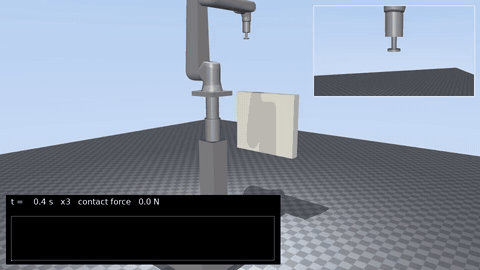
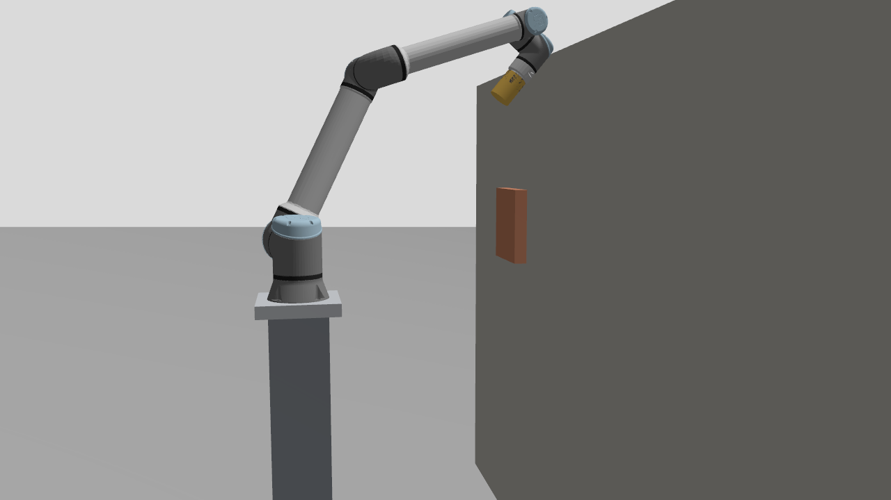
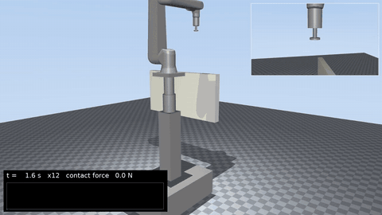
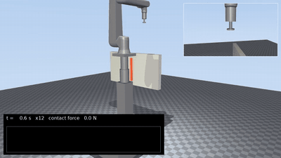

# Motion Planner

ROS 2 packages for covering a surface with a tool using a mobile manipulator: sensor data to coverage
plan, base stands, arm motion planning and execution on a compliant (admittance) controller with force
feedback. The target is a stack that works for any arm, lift and base (chosen by a robot profile) and any
tool (contact like a mop, non-contact like a spray gun), in simulation first and on hardware by parameters.

**Status in one line:** the building blocks exist and are tested, and both simulators now run the pipeline
end to end in headless one-command passes (coverage planner, manager, MoveIt, compliant controller, recorded
and scored), including multi-stand passes where the base drives between stands. Nothing here has run on hardware.
The per-area checklist, with evidence for every item, is [docs/ROADMAP.md](docs/ROADMAP.md).

**Where it stands (2026-11-22, main at #173):**
- **Single-stand wall passes** in MuJoCo are reliable (8 of 8 runs across four scenarios, with obstacles).
- **Two-stand passes in MuJoCo pass**, with MoveIt/OMPL and with cuRobo. The latest run (MoveIt/OMPL, scored on the tool pose after #167 and
  #172, one run): 10 of 10 columns, coverage 100 %, tool tilt at most 0.15 deg, wall gap at most 0.9 mm, peak force 22.1 N against a 10 N
  target ([video below](#two-stand-pass-with-moveit-scored-on-the-tool-pose-mujoco)). Earlier same-session batches: 6 of 8 before the
  second-stand fix and 8 of 8 after (not significant on its own).
- **cuRobo v0.9.0 as the free-space planner** completed a two-stand MuJoCo pass four times (10 of 10 columns, peaks 46.8 to 72.4 N), but
  MoveIt/OMPL still planned the stow and the second stand: cuRobo found no docked-to-stow path (its model treats low lift with the arm swung
  out as in collision) or did not answer in time, and it needs 12 to 16 s per plan on the 4 GB laptop GPU. A `free_space_fallback` makes the
  hand-over automatic and logged; a start/goal precheck, a 7-joint collision-matrix fix (`--ignore-hops 2`) and a joint limit guard are in,
  but the cause of the low-lift refusal is a hypothesis until a GPU run confirms it ([docs/curobo_v2_notes.md](docs/curobo_v2_notes.md)).
- **Gazebo two-stand passes still fail.** After the start-state clamps (#156, #157, no "start state out of bounds" error is left) the pass
  completed 1 of 10 columns in the latest run (6 of 10 in the one before; the pass varies a lot between runs). The log shows the dock IK
  jumping to another arm branch (shoulder pan -0.62 to +2.49 rad) and the wrist winding, after which every column fails. An opt-in dock IK
  continuity choice (`dock_ik_continuity`, #169) targets that; it has not been measured in Gazebo on main yet
  ([docs/sim_gazebo.md](docs/sim_gazebo.md)).
- **Merged since the cuRobo work, mostly host-tested only (no simulator, GPU or hardware run unless stated):** column-sequence feasibility
  (approach, contact, strokes, retract; split avoidance), an RM4D-backed column port in the manager (advisory, off by default), `ColumnIkChain`
  and a path quality audit (not yet called by the planner), a stand-check gate and dock IK continuity (both opt-in), N-DOF arms and a
  redundancy policy for maps (FR3, iiwa 7, Kinova Gen3, xArm 7, UR3e to UR20), tool-pose scoring (tilt, wall gap), plane-generic stands and a
  base placement optimiser (ceilings, corners), a differential-IK core, a runtime safety monitor core (**not a certified safety function**),
  tool contact frame, tilt and plane-touch calibration, a teleoperation core and a lateral dock term. The list with evidence is
  [CHANGELOG.md](CHANGELOG.md) and [docs/ROADMAP.md](docs/ROADMAP.md#19-since-143-what-merged-and-what-it-is-worth).
- **Navigation and perception are the weakest links.** The base drives a straight line to each stand on ground-truth simulator odometry (no map, no obstacle avoidance, no localisation, no Nav2), wall docking and `wall_detector` are not started in the two-stand passes (the wall is pre-baked), and the self filter is not in any pass. [docs/navigation_and_perception.md](docs/navigation_and_perception.md) has the component table and the ordered gap list.
- **Nothing has run on hardware.**
- Open work and exit tests: [docs/ROADMAP.md](docs/ROADMAP.md); the handoff: [docs/dev_handoff.md](docs/dev_handoff.md); the order of
  the next themes: [docs/development_plan.md](docs/development_plan.md).

```
sensors -> perception -> self filter -> scene -> surface -> coverage (tool-aware) -> base stands
        -> navigation / docking -> motion planning -> execution (JTAC + F/T) -> monitoring
```

## Packages

Under `src/`, by area (layout rules: [docs/package_layout.md](docs/package_layout.md); every package has a README, and [docs/modules.md](docs/modules.md) maps them all: tier, what each needs, dependency layers, recipes for reusing a part).

| Area | Packages | What they do |
|---|---|---|
| Common | `core_types`, `ros_adapters`, `force_core`, `tool_calibration` | ROS-free types and ports, conversions to ROS messages, the force-control core (contact state machine, wrench conditioning), the tool calibration record |
| Description | `mobile_manipulator_description`, `mobile_manipulator_moveit_config`, `mobile_manipulator_profile` | Generic robot model (base + lift + N-DOF arm + tool, all swappable) with 13 profiles, MoveIt 2 config generated from a profile, header-only profile loader |
| Perception | `scene_model`, `scene_adapters`, `robot_self_filter`, `wall_detector`, `coverage_planner`, `coverage_planner_msgs` | Scene model (clouds, meshes, voxels, ESDF, loaders), scene to planner geometry, robot self filter (library and node), wall detection from a live point cloud, wall coverage planning (boustrophedon, sweepline, wall patterns, scan to plan) |
| Manipulation | `motion_planner`, `motion_planner_moveit`, `vamp_planner`, `curobo_bridge`, `curobo_bridge_msgs`, `curobo_planner`, `reachability`, `reachability_moveit`, `reachability_msgs`, `manipulation_manager`, `coverage_task_msgs`, `stand_navigator`, `stand_navigator_msgs`, `manipulation_bt_prototype` | Planner, IK, collision and scene ports; MoveIt/OMPL, VAMP and cuRobo v2 backends; RM4D reachability map and multi-stand planning; base navigation and wall docking to a stand; the manager that runs coverage, planning and execution |
| Control | `compliant_trajectory_controller`, `ft_bridge_hardware`, `ft_conditioner` | JTAC (admittance joint trajectory controller for `ros2_control`), F/T sensor bridge, wrench conditioning node |
| Simulation | `sim_mujoco`, `sim_gazebo`, `sim_isaac` | MuJoCo 4 and Gazebo Harmonic backends behind `hardware:=mujoco` / `hardware:=gazebo`; `sim_isaac` is a stub |

## Build and test (Docker)

The supported environment is the Docker image (ROS 2 Jazzy). From the repo root:

```bash
docker compose -f docker/compose.yaml build dev
docker compose -f docker/compose.yaml run --rm test     # colcon build + colcon test, no GPU
docker compose -f docker/compose.yaml run --rm dev      # interactive shell, repo mounted at /ws
```

Inside a shell: `docker/build.sh test` builds the workspace and prints the test summary. GPU targets
(`gpu`, `full`: cuRobo v2, VAMP) and the simulator images are described in [docs/docker.md](docs/docker.md).
Building outside Docker needs ROS 2, MoveIt 2, `ros2_control` and the packages in `docker/apt-extra.txt`.
The last full run recorded in the roadmap: 736 colcon tests in 26 packages, no failures. There is
CI runs the build, the colcon tests and the repository checks on free GitHub-hosted runners
([.github/workflows/ci.yml](.github/workflows/ci.yml)). It does not run simulators, GPU planners or hardware; those
are run locally, and [CONTRIBUTING.md](CONTRIBUTING.md) lists every check.

## Showcase

A full MuJoCo manager pass on a plain wall (`run_manager_pass.sh`: coverage plan, dock, press, three stroke columns, retract),
rendered headless from the recorded joint states with `render_run.py`. The gif is the run at 9x, the
[mp4](docs/media/manager_pass.mp4) at 3x with a force trace.



| Robot overview | Arm at the wall, mid-stroke | Tool on the wall |
|---|---|---|
|  |  |  |


A non-contact pass, filmed the same way (`run_spray_pass.sh`: a spray gun held 0.30 m from the wall, valve open only during the strokes;
the orange cone and the spots on the wall are drawn by `render_run.py --valve-log`, the sim itself has no spray). The gif is at 9x, the
[mp4](docs/media/spray_pass.mp4) at 3x. Scored (`score_run --no-contact`, spray cone half-angle 20 deg): 3 columns done, coverage 100 %
(930 of 930 cells), thickness CoV 0.52, valve open 15.6 s of 94.2 s, whole-run peak force 0.0 N.


Scored result of the contact run above (`score_run`, 10 N target, 1.5 N band): 3 columns done, 0 partial, 0 failed; coverage
93.1 % (866 of 930 cells); peak force 19.2 N; RMS force error 3.6 N; 49 % of the contact samples in the band; 144 s of
simulated time, 83 s engaged. While stroking, the force ripples between 0 and about 18 N around the 10 N target. Nothing is
tuned for the picture. The pass was run three times for filming: 93.1 % / 18.5 N / 3.6 N, 93.1 % / 19.2 N / 3.6 N (shown), and
a first run with 93.3 % / 153.4 N / 8.0 N, which was made while the host was heavily loaded by other simulations and builds
(load average 10 to 27); the cause was not isolated, but the two reruns on a quieter host agree with each other and with the standard run. How the media is made:
[docs/sim_mujoco.md](docs/sim_mujoco.md#rendering-photos-and-videos). The same non-contact pass in Gazebo (`sim_gazebo/scripts/run_spray_pass.sh`, colour camera `rgb_camera:=true`, UR meshes `arm_meshes:=true`,
stills from `capture_still.py`): the arm mid-stroke at the wall, and during the seeded first move. These stills come from a run with the arm meshes
loaded, which also gives the arm collision geometry; that run scored 0.58 coverage (the plain runs without meshes: 1.0). Details and the numbers:
[docs/sim_gazebo.md](docs/sim_gazebo.md#spray-pass-and-multi-stand-pass-parity-with-mujoco).

| Gazebo: first move to the stroke | Gazebo: mid-stroke |
|---|---|
|  |  |

### Two-stand pass with MoveIt, scored on the tool pose (MuJoCo)

The same `run_multi_stand_pass.sh` on `two_panels_plain` with the default MoveIt/OMPL planners (no GPU node), on main after the tool-pose
scoring (#167) and the review fixes (#172); filmed 2026-11-22. The video is the run at 12x (551 s of simulated time, 46 s of video) with the
contact force trace and a close-up of the tool; [mp4](docs/media/two_stand_moveit.mp4). It replaces a first version of this video that was drawn
without the driven base pose (the arm sat at the origin, 90 degrees off the wall); the renderer and the live viewer now replay the base pose.



Scored result of the filmed run (`score_run`, one run, made with the live viewer open and the host busy): 10 columns done, 0 partial, 0 failed
(stand 0: 6, stand 1: 4); coverage 100 % (2790 of 2790 cells); peak force 142.2 N scored, 20.9 N in the feedback; RMS force error 6.7 N; 34 % of the
contact samples in the force band; tool tilt at most 31.8 deg (a transient: 0 tilted samples and 0 bad-pose samples by the scorer's rule), wall gap
at most 15.8 mm; 277 s engaged. The 142 N is one spike between the two stands (visible in the force trace of the video at about 430 s of simulated time);
its cause is not found. An earlier run of the same pass without the viewer scored 10 of 10, coverage 1.0, peak 22.1 N, tilt at most 0.15 deg, wall gap at
most 0.9 mm. This pass runs the seeded dock IK (`dock_ik_seeded`), which is tuned for MuJoCo; the same pass in Gazebo still fails
([docs/sim_gazebo.md](docs/sim_gazebo.md)).

### cuRobo in a two-stand pass (MuJoCo)

`run_multi_stand_pass.sh` on `two_panels_plain` (a free base, two stands, ten columns), with cuRobo v0.9.0 selected as the free-space planner
(`planning_curobo.yaml`, MoveIt/OMPL as the fallback) and the wall pushed to the cuRobo node at every stand. The video is the run at 12x
(1128 s of simulated time), with the contact force trace and a close-up of the tool; [mp4](docs/media/multi_stand_curobo.mp4).


*Note (2026-11-22): this video was rendered before the renderer replayed the driven base pose, so the arm is drawn at the origin and not where the base was; the numbers below are from the run itself. It needs a rerun with the GPU node to be redrawn.*

Scored result of that run: 10 columns done, 0 partial, 0 failed; coverage 100 % (2790 of 2790 cells); peak force 69.3 N (target 10 N);
RMS force error 5.1 N; 33 % of the contact samples in the 1.5 N band; one collision-monitor line (a lift link pair at depth 0 in the first
10 ms). Planner use in the run: cuRobo planned 7 segments (the priming move and 6 stand-0 approaches: 10 to 16 s of planning each, 0.4 to
0.7 s of motion), MoveIt/OMPL planned the other 6 free-space segments (including the stow and the second stand), 4 to 50 s of motion each, because
cuRobo's service did not answer for the stow (`unavailable`). Three earlier runs with the same setup also passed (peaks 46.8, 48.2, 72.4 N).
Before those, three runs failed or stalled and each led to a fix (a 256-box cache that turned the wall into 20 cm slabs, a missing waypoint
count that made every cuRobo plan look partial, the dock-to-stow move cuRobo cannot plan); the story and the commands:
[docs/sim_mujoco.md](docs/sim_mujoco.md#running-a-pass-with-curobo-as-the-planner). The cuRobo moves are about 14 times faster than the
MoveIt-retimed ones in the sim, far above what the MoveIt retiming allows, and have not been checked against the real arm's limits: do not run them on hardware as they are.

### Obstacle scenarios (MuJoCo)

`run_scenarios.sh` runs named walls through the manager pass (UR10e, each scenario twice). One filmed run per scenario is shown; the
failing one is included on purpose. Full results, load averages and the failure analysis:
[docs/sim_mujoco.md](docs/sim_mujoco.md#scenario-set-obstacles-on-the-wall).

| scenario | runs passed | filmed run | film | force and coverage |
|---|---|---|---|---|
| plain | 2 of 2 | pass, coverage 1.000, peak 21.4 N |  | [plot](docs/media/scenario_plain.png) |
| plain_wide | 2 of 2 | pass, coverage 1.000, peak 19.9 N |  | [plot](docs/media/scenario_plain_wide.png) |
| window (hole in the wall) | 2 of 2 | pass, reachable coverage 1.000, peak 22.3 N |  | [plot](docs/media/scenario_window.png) |
| protrusion | 2 of 2 | pass, reachable coverage 0.983, peak 20.6 N |  | [plot](docs/media/scenario_protrusion.png) |
| two_panels (two stands, a rib) | 0 of 2 | **fail**, reachable coverage 0.670, peak 128.3 N |  | [plot](docs/media/scenario_two_panels.png) |
| two_panels_plain (two stands, no obstacle) | 1 of 2 | pass, coverage 1.000, one 451 N press transient |  | [plot](docs/media/scenario_two_panels_plain.png) |

The single-stand scenarios pass, with peaks near 20 N against a 10 N target. The two-stand ones fail about every second run at the second stand,
including on a plain wall, so it is not the obstacle: the approach to the first columns is refused six times in a row by collision truncation
and recovery finds no safe configuration. The cause is not isolated (the arm's pose at the second stand is the suspect). Several host loads were
10 to 14 during these runs, recorded per run in the docs. No hardware was involved.

**Update, 2026-11-20 (same-session batches of 8, MuJoCo):** after the second-stand fix `two_panels_plain` passed 8 of 8 (6 of 8 on the code before it) and `two_panels` 8 of 8 on
both code states, scored on the reachable wall. The `two_panels` row above (0 of 2, coverage 0.670) was measured before the reachability and keep-out changes that
are now in; the 0.88 wall coverage the pass script prints for `two_panels` is the whole-wall figure, not the reachable-wall one the scenario judges. Details:
[docs/sim_mujoco.md](docs/sim_mujoco.md#scenario-set-obstacles-on-the-wall).

## Simulators

Both run headless and sit behind `ros2_control`, so the same controllers run against them as against
hardware ([docs/simulation.md](docs/simulation.md)).

| | MuJoCo 4 (`sim_mujoco`) | Gazebo Harmonic (`sim_gazebo`) |
|---|---|---|
| Docs | [docs/sim_mujoco.md](docs/sim_mujoco.md) | [docs/sim_gazebo.md](docs/sim_gazebo.md) |
| Environment | `build` image with the MuJoCo SDK mounted (`MUJOCO_ROOT`); Python tools also in the `sim` image | `sim-gazebo` image |
| Can do today | Position and JTAC control of lift + arm, wall worlds from `wall_scene.json`, raw wrist F/T plus ground-truth contact wrench, conditioned force path, a 10 N contact test that holds (10.13 N for a 10 N target) | Same joint control and wall worlds, raw F/T plus ground truth, conditioned path validated against ground truth, holds 10 N with a compliant tip, free base, depth and colour camera, spray and multi-stand passes |
| Cannot do today | Wheel, floor or slip physics; odometry is the simulated pose, no noise; the depth sensor is a ray cast, not a rendered image | Wheel physics, odom noise; the contact is compliant only through a 20 mm tool tip spring |

Isaac Sim is a stub.

## Quickstart: a simulated wall pass

Needs a built workspace (see above) with a sourced ROS environment; the MuJoCo scripts also need the MuJoCo SDK
(`MUJOCO_ROOT`, [docs/sim_mujoco.md](docs/sim_mujoco.md)), the Gazebo one needs the `sim-gazebo` image
([docs/docker.md](docs/docker.md)). Each script launches the sim headless, runs the pass, records it and scores it.

```bash
# MuJoCo: scripted wall strokes planned by MoveIt
bash $(ros2 pkg prefix sim_mujoco)/lib/sim_mujoco/run_wall_pass.sh
# MuJoCo: coverage planner -> manipulation_manager -> MoveIt -> JTAC
bash $(ros2 pkg prefix sim_mujoco)/lib/sim_mujoco/run_manager_pass.sh
# Gazebo Harmonic: the same manager pass (about 5 minutes)
bash $(ros2 pkg prefix sim_gazebo)/lib/sim_gazebo/run_manager_pass.sh
# Gazebo: non-contact spray pass, and the multi-stand pass (free base, two stands)
bash $(ros2 pkg prefix sim_gazebo)/lib/sim_gazebo/run_spray_pass.sh
bash $(ros2 pkg prefix sim_gazebo)/lib/sim_gazebo/run_multi_stand_pass.sh
```

Sources: `src/simulation/sim_mujoco/scripts/`, `src/simulation/sim_gazebo/scripts/`.

## What you can run today

- MoveIt demo on the description with mock hardware: `ros2 launch mobile_manipulator_moveit_config demo.launch.py arm:=ur10e`
- Wall coverage planning from a scene file: `ros2 launch coverage_planner wall_coverage_demo.launch.py`
- Reachability map building and stand planning (`rm4d_tool`, `reachability_node`): [docs/reachability.md](docs/reachability.md)
- The simulated wall passes above, and the smoke and contact tests of each simulator. Base navigation is a straight-line stand-in on ground-truth odometry, and the two-stand passes use a pre-baked wall rather than live perception: [docs/navigation_and_perception.md](docs/navigation_and_perception.md) says what is real and what is not
- A two-stand pass with cuRobo as the free-space planner: [docs/sim_mujoco.md](docs/sim_mujoco.md#running-a-pass-with-curobo-as-the-planner)

## Documentation

[docs/README.md](docs/README.md) is the index: [architecture](docs/architecture.md), [robot description](docs/robot_description.md),
[design principles](docs/design_principles.md), [decision records](docs/adr/), [how to read a run](docs/how_to_read_a_run.md) (the files a pass writes and what each field means). Third-party software and licences:
[THIRD_PARTY.md](THIRD_PARTY.md). Changes: [CHANGELOG.md](CHANGELOG.md). Contributing: [CONTRIBUTING.md](CONTRIBUTING.md).

## License

Apache License 2.0. See [LICENSE](LICENSE).
