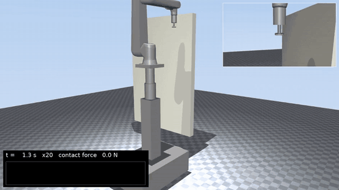

# Motion Planner

ROS 2 packages for covering a surface with a tool using a mobile manipulator: sensor data to coverage
plan, base stands, arm motion planning and execution on a compliant (admittance) controller with force
feedback. The target is a stack that works for any arm, lift and base (chosen by a robot profile) and any
tool (contact like a mop, non-contact like a spray gun), in simulation first and on hardware by parameters.

**Status in one line:** the building blocks exist and are tested, and both simulators now run the pipeline
end to end in headless one-command passes (coverage planner, manager, MoveIt, compliant controller, recorded
and scored), including multi-stand passes where the base drives between stands. Nothing here has run on hardware.
The per-area checklist, with evidence for every item, is [docs/ROADMAP.md](docs/ROADMAP.md).

**Where it stands (2026-11-22, main at #204):**
- **Single-stand wall passes** in MuJoCo are reliable (8 of 8 runs across four scenarios, with obstacles).
- **Two-stand passes in MuJoCo pass**, with MoveIt/OMPL and with cuRobo. The latest run (MoveIt/OMPL, scored on the tool pose after #167 and
  #172, one run): 10 of 10 columns, coverage 100 %, tool tilt at most 0.15 deg, wall gap at most 0.9 mm, peak force 22.1 N against a 10 N
  target ([older run](docs/sim_mujoco.md), superseded by [Latest runs](#latest-runs)). Earlier same-session batches: 6 of 8 before the
  second-stand fix and 8 of 8 after (not significant on its own).
- **cuRobo v0.9.0 as the free-space planner** completed a two-stand MuJoCo pass four times (10 of 10 columns, peaks 46.8 to 72.4 N), but
  MoveIt/OMPL still planned the stow and the second stand: cuRobo found no docked-to-stow path (its model treats low lift with the arm swung
  out as in collision) or did not answer in time, and it needs 12 to 16 s per plan on the 4 GB laptop GPU. A `free_space_fallback` makes the
  hand-over automatic and logged; a start/goal precheck, a 7-joint collision-matrix fix (`--ignore-hops 2`) and a joint limit guard are in,
  but the cause of the low-lift refusal is a hypothesis until a GPU run confirms it ([docs/curobo_v2_notes.md](docs/curobo_v2_notes.md)).
- **Gazebo two-stand pass: failed on main, passes with the joint gain at 2 /s.** On main the pass completed 3 of 10 columns (coverage 0.32,
  peak 1886 N, wall gap 57 mm, 1592 s). The cause is gz_ros2_control's joint position loop (gain 0.1 /s, a 10 s time constant): the arm
  is still converging when the manager docks. `run_multi_stand_pass.sh` now sets `position_gain:=2.0`: 4 of 4 runs, 10 of 10 columns, coverage 100 %,
  peak 45 to 59 N, wall gap at most 15 mm, about 9 minutes. Gains 3 and 4 bounce on the wall, 1 still fails columns. Force quality is behind MuJoCo (about 20 N);
  other profiles and a tall wall are not measured ([docs/sim_gazebo.md](docs/sim_gazebo.md)).
- **Merged since the cuRobo work, mostly host-tested only (no simulator, GPU or hardware run unless stated):** column-sequence feasibility
  (approach, contact, strokes, retract; split avoidance), an RM4D-backed column port in the manager (advisory, off by default), `ColumnIkChain`
  and a path quality audit (not yet called by the planner), a stand-check gate and dock IK continuity (both opt-in), N-DOF arms and a
  redundancy policy for maps (FR3, iiwa 7, Kinova Gen3, xArm 7, UR3e to UR20), tool-pose scoring (tilt, wall gap), plane-generic stands and a
  base placement optimiser (ceilings, corners), a differential-IK core, a runtime safety monitor core (**not a certified safety function**),
  tool contact frame, tilt and plane-touch calibration, a teleoperation core and a lateral dock term. The list with evidence is
  [CHANGELOG.md](CHANGELOG.md) and [docs/ROADMAP.md](docs/ROADMAP.md#19-since-143-what-merged-and-what-it-is-worth).
- **Newest additions (#198 and #203), each with an honest tag.** "Host-tested only" means unit tests or host builds and no simulator run; "unbuilt" means the ROS node wiring was not compiled in a workspace image.
  | Addition | Tag | Where |
  |---|---|---|
  | Coverage paint (live done / not done wall map, `run.csv` replay to a PNG and a percent) | host-tested only (31 pytest); node, RViz, Gazebo and MuJoCo drawing never run | [docs/sim_overlay.md](docs/sim_overlay.md) |
  | Plan and stand overlay inside Gazebo and MuJoCo | host-tested only (gz commands dry-run); never run in a simulator | [docs/sim_overlay.md](docs/sim_overlay.md) |
  | Reach report (reach fractions per lift height, minimum lift positions, flags, heat strip from an RM4D map) | host-tested only (pytest on an analytic map); Python tool, no simulator involved | [docs/reachability.md](docs/reachability.md) |
  | Stand navigation planner (grid A* over the wall scene, shortcut, waypoint follower; opt-in) | host-tested only; the MuJoCo switch `MULTI_STAND_PATH_PLANNER` is not yet measured; `MULTI_STAND_WALL_DOCK=1` ran in one two-stand MuJoCo pass (same scorecard as without it, one run) | [docs/stand_navigation.md](docs/stand_navigation.md) |
  | Perception-in-the-loop mode (`MULTI_STAND_PERCEPTION=1`: simulated cloud to `wall_detector` to the coverage planner) | host-tested only (Python mirror of the fit); C++ node and simulator run unbuilt; `wall_detector` reports no obstacles | [docs/perception_live.md](docs/perception_live.md) |
  | Plan redundancy report (`plan_redundancy_report`, `score_run --plan`: jumps, repeated strokes, strip and stand order) | host-tested only (host g++ gtests); not built in the ROS image | [docs/coverage_planner.md](docs/coverage_planner.md) |
  | Chained columns (`chain_columns`, one straight move between neighbouring columns; on by default since #292) | built and run in the MuJoCo and Gazebo passes under [Latest runs](#latest-runs) | [docs/manager_parameters.md](docs/manager_parameters.md) |
  | Scenario sync, standoff advisor, per-module RViz profiles, plan-only playback | host-tested only | [docs/scenario_sync.md](docs/scenario_sync.md), [docs/standoff.md](docs/standoff.md), [docs/rviz/README.md](docs/rviz/README.md) |
  | Navigation safety layer (stale odometry, command gate, stuck detection, scan/cloud obstacle stop; default-on checks, tested not to change healthy runs) | host-tested only (pytest); built and unit-tested in the ROS image with the batch, never run in a simulator | [docs/stand_navigation.md](docs/stand_navigation.md#base-safety-layer-and-the-nav2-backend) |
  | Nav2 adapter (`backend:=nav2`, goal conversion and result mapping) | host-tested only (fake Nav2 client); no image has Nav2, so never run against a real Nav2 | [docs/stand_navigation.md](docs/stand_navigation.md#nav2-swap-path) |
  | Wall dock step after `navigate_to_stand` (opt-in, feeds the stand check and the verify result) | host-tested only (gtests on the gate); built with the batch, never run in a simulator | [docs/manager_parameters.md](docs/manager_parameters.md) |
  | Failed-column retry (`retry_failed_columns`, next dock IK solution, fresh stow, optional stand re-plan; opt-in) | host-tested only (gtests on the policy); built with the batch, no simulator run yet | [docs/manager_parameters.md](docs/manager_parameters.md) |
  | Touch-up plan (undone cells of a recorded run to a serpentine `coverage_output.json`) | host-tested only (pytest); the plan has not been executed by the manager in a simulator | [docs/sim_overlay.md](docs/sim_overlay.md) |
  | Gazebo multi-stand script parity with MuJoCo (double pass, reach, clearance, tall patch knobs) | host-tested only (script test); the Gazebo tall wall has never run, unverified in sim | [docs/sim_gazebo.md](docs/sim_gazebo.md) |

  None of these is verified in a simulator yet (the batch-2 rows were built and unit-tested in the ROS image, no more); the verified-in-sim results are the MuJoCo passes above.
- **Navigation and perception are the weakest links.** The base drives a straight line to each stand on ground-truth simulator odometry (no map, no localisation; an opt-in planner, safety layer and Nav2 adapter now exist but have not run in a simulator), wall docking and `wall_detector` are not started in the two-stand passes (the wall is pre-baked), and the self filter is not in any pass. [docs/navigation_and_perception.md](docs/navigation_and_perception.md) has the component table and the ordered gap list.
- **Nothing has run on hardware.**
- What is untested on real hardware, in commissioning order: [docs/hardware_readiness.md](docs/hardware_readiness.md).
- Open work and exit tests: [docs/ROADMAP.md](docs/ROADMAP.md); the handoff: [docs/dev_handoff.md](docs/dev_handoff.md); the order of
  the next themes: [docs/development_plan.md](docs/development_plan.md).

```
sensors -> perception -> self filter -> scene -> surface -> coverage (tool-aware) -> base stands
        -> navigation / docking -> motion planning -> execution (JTAC + F/T) -> monitoring
```

## Packages

Under `src/`, by area (layout rules: [docs/package_layout.md](docs/package_layout.md); every package has a README, and [docs/modules.md](docs/modules.md) maps them all: tier, what each needs, dependency layers, recipes for reusing a part).

| Area | Packages | What they do |
|---|---|---|
| Common | `core_types`, `ros_adapters`, `force_core`, `tool_calibration`, `standoff_advisor` | ROS-free types and ports, conversions to ROS messages, the force-control core (contact state machine, wrench conditioning), the tool calibration record, the base-to-wall standoff advisor |
| Description | `mobile_manipulator_description`, `mobile_manipulator_moveit_config`, `mobile_manipulator_profile` | Generic robot model (base + lift + N-DOF arm + tool, all swappable) with 13 profiles, MoveIt 2 config generated from a profile, header-only profile loader |
| Perception | `scene_model`, `scene_adapters`, `robot_self_filter`, `wall_detector`, `coverage_planner`, `coverage_planner_msgs` | Scene model (clouds, meshes, voxels, ESDF, loaders), scene to planner geometry, robot self filter (library and node), wall detection from a live point cloud, wall coverage planning (boustrophedon, sweepline, wall patterns, scan to plan) |
| Manipulation | `motion_planner`, `motion_planner_moveit`, `vamp_planner`, `curobo_bridge`, `curobo_bridge_msgs`, `curobo_planner`, `reachability`, `reachability_moveit`, `reachability_msgs`, `manipulation_manager`, `coverage_task_msgs`, `stand_navigator`, `stand_navigator_msgs`, `manipulation_bt_prototype` | Planner, IK, collision and scene ports; MoveIt/OMPL, VAMP and cuRobo v2 backends; RM4D reachability map and multi-stand planning; base navigation and wall docking to a stand; the manager that runs coverage, planning and execution |
| Control | `compliant_trajectory_controller`, `ft_bridge_hardware`, `ft_conditioner` | JTAC (admittance joint trajectory controller for `ros2_control`), F/T sensor bridge, wrench conditioning node |
| Simulation | `sim_mujoco`, `sim_gazebo`, `sim_isaac` | MuJoCo 4 and Gazebo Harmonic backends behind `hardware:=mujoco` / `hardware:=gazebo`; `sim_isaac` is a stub |

## Build and test (Docker)

The supported environment is the Docker image (ROS 2 Jazzy). From the repo root:

```bash
docker compose -f docker/compose.yaml build dev
docker compose -f docker/compose.yaml run --rm test     # colcon build + colcon test, no GPU
docker compose -f docker/compose.yaml run --rm dev      # interactive shell, repo mounted at /ws
```

Inside a shell: `docker/build.sh test` builds the workspace and prints the test summary. GPU targets
(`gpu`, `full`: cuRobo v2, VAMP) and the simulator images are described in [docs/docker.md](docs/docker.md).
Building outside Docker needs ROS 2, MoveIt 2, `ros2_control` and the packages in `docker/apt-extra.txt`.
The last full run recorded in the roadmap: 736 colcon tests in 26 packages, no failures. There is
CI runs the build, the colcon tests and the repository checks on free GitHub-hosted runners
([.github/workflows/ci.yml](.github/workflows/ci.yml)). It does not run simulators, GPU planners or hardware; those
are run locally, and [CONTRIBUTING.md](CONTRIBUTING.md) lists every check.

## Latest runs

Two-stand wall passes (`run_multi_stand_pass.sh`) on current main with the defaults of #292: `serpentine_columns`, `chain_columns` and
`contact_connectors` on (one pass per strip, strips joined by connectors that stay in contact), `contact_wiper` one pass, tool speed
0.01 m/s. Recorded 2026-11-26/27, one run each, not repeated, so no spread is claimed. Peak and p99 are over every `run.csv` force sample
(the scorer's `score_run`); the speed is the median over contact windows (force above 3 N, chord over at least 0.5 s, target 0.01 m/s,
[docs/tcp_speed.md](docs/tcp_speed.md)). Only the contact strokes are held to a speed.

| Run | Simulator | Columns done | Connectors used / fell back | Peak force | p99 force | Duration | TCP speed median | Note |
|---|---|---|---|---|---|---|---|---|
| `mujoco-final-tall` | MuJoCo | 10 of 10 (0 partial, 0 failed) | 8 / 0 | 307.3 N | 19.8 N | 1752 s | 0.00806 m/s (-19 %) | `two_panels_tall`, UR10e telescopic profile, lift cost 2x; 227 samples above 60 N, 55 "Cartesian offset diverged" resets |
| `gazebo-final-onewall` | Gazebo | 10 of 10 | 8 / 0 | 8367 N | 173.7 N | 515 s | 0.01006 m/s (+0.6 %) | plain wall, joint position gain 2; single-sample spikes, 460 samples above 500 N |
| `mujoco-connectors2` (earlier) | MuJoCo | 10 of 10 | 8 / 0 | 293.2 N | 19.6 N | 1898 s | 0.00969 m/s (-3.1 %) | same idea, earlier build |
| `mujoco-main-liftcost` (earlier) | MuJoCo | 10 of 10 | none (old non-serpentine column mode) | 21.1 N | 14.3 N | 1774 s | 0.00942 m/s (-5.8 %) | same speed as the tall run, for comparison |



The MuJoCo tall-wall run above, drawn from the recorded joint states with `render_run.py` at 20x (1752 s of simulated time in 88 s of video),
with the contact force trace and a close-up of the tool (the gif is a smaller copy, 560 px wide at 6 fps; [mp4](docs/media/latest_mujoco_tall.mp4)). How the media is made:
[docs/sim_mujoco.md](docs/sim_mujoco.md#rendering-photos-and-videos). There is no video of the Gazebo run (no film was recorded for it).

What is not good yet:

- **Force spikes in serpentine mode.** The tall-wall run peaked at 307 N (the old column mode peaked at 21.1 N at the same speed), mostly
  mid-stroke, with 55 "Cartesian offset diverged" resets in the simulator log. The cause is open.
- **Gazebo contact quality.** `run.csv` peaks at 8367 N in single samples (p99 174 N), while the manager's own filtered feedback peak is much
  lower; the two disagree and this is under investigation. Columns finish, but the force is not under control there.
- **Nothing on hardware.** All of this is simulation. The TCP-speed median is below the target in the MuJoCo runs, and the mean sits well below the median
  (windows near standstill at column ends, turns and force dips), so the speed is kept in the median, not at every sample
  ([docs/tcp_speed.md](docs/tcp_speed.md)).

More: [docs/sim_mujoco.md](docs/sim_mujoco.md), [docs/sim_gazebo.md](docs/sim_gazebo.md), [docs/how_to_read_a_run.md](docs/how_to_read_a_run.md),
[docs/manager_parameters.md](docs/manager_parameters.md#chained-columns-chain_columnstrue).

## Simulators

Both run headless and sit behind `ros2_control`, so the same controllers run against them as against
hardware ([docs/simulation.md](docs/simulation.md)).

| | MuJoCo 4 (`sim_mujoco`) | Gazebo Harmonic (`sim_gazebo`) |
|---|---|---|
| Docs | [docs/sim_mujoco.md](docs/sim_mujoco.md) | [docs/sim_gazebo.md](docs/sim_gazebo.md) |
| Environment | `build` image with the MuJoCo SDK mounted (`MUJOCO_ROOT`); Python tools also in the `sim` image | `sim-gazebo` image |
| Can do today | Position and JTAC control of lift + arm, wall worlds from `wall_scene.json`, raw wrist F/T plus ground-truth contact wrench, conditioned force path, a 10 N contact test that holds (10.13 N for a 10 N target) | Same joint control and wall worlds, raw F/T plus ground truth, conditioned path validated against ground truth, holds 10 N with a compliant tip, free base, depth and colour camera, spray and multi-stand passes |
| Cannot do today | Wheel, floor or slip physics; odometry is the simulated pose, no noise; the depth sensor is a ray cast, not a rendered image | Wheel physics, odom noise; the contact is compliant only through a 20 mm tool tip spring |

Isaac Sim is a stub.

## Quickstart: a simulated wall pass

Needs a built workspace (see above) with a sourced ROS environment; the MuJoCo scripts also need the MuJoCo SDK
(`MUJOCO_ROOT`, [docs/sim_mujoco.md](docs/sim_mujoco.md)), the Gazebo one needs the `sim-gazebo` image
([docs/docker.md](docs/docker.md)). Each script launches the sim headless, runs the pass, records it and scores it.

```bash
# MuJoCo: scripted wall strokes planned by MoveIt
bash $(ros2 pkg prefix sim_mujoco)/lib/sim_mujoco/run_wall_pass.sh
# MuJoCo: coverage planner -> manipulation_manager -> MoveIt -> JTAC
bash $(ros2 pkg prefix sim_mujoco)/lib/sim_mujoco/run_manager_pass.sh
# Gazebo Harmonic: the same manager pass (about 5 minutes)
bash $(ros2 pkg prefix sim_gazebo)/lib/sim_gazebo/run_manager_pass.sh
# Gazebo: non-contact spray pass, and the multi-stand pass (free base, two stands)
bash $(ros2 pkg prefix sim_gazebo)/lib/sim_gazebo/run_spray_pass.sh
bash $(ros2 pkg prefix sim_gazebo)/lib/sim_gazebo/run_multi_stand_pass.sh
```

Sources: `src/simulation/sim_mujoco/scripts/`, `src/simulation/sim_gazebo/scripts/`.

## What you can run today

- MoveIt demo on the description with mock hardware: `ros2 launch mobile_manipulator_moveit_config demo.launch.py arm:=ur10e`
- Wall coverage planning from a scene file: `ros2 launch coverage_planner wall_coverage_demo.launch.py`
- Reachability map building and stand planning (`rm4d_tool`, `reachability_node`): [docs/reachability.md](docs/reachability.md)
- The simulated wall passes above, and the smoke and contact tests of each simulator. Base navigation is a straight-line stand-in on ground-truth odometry, and the two-stand passes use a pre-baked wall rather than live perception: [docs/navigation_and_perception.md](docs/navigation_and_perception.md) says what is real and what is not
- A two-stand pass with cuRobo as the free-space planner: [docs/sim_mujoco.md](docs/sim_mujoco.md#running-a-pass-with-curobo-as-the-planner)

## Documentation

[docs/README.md](docs/README.md) is the index: [architecture](docs/architecture.md), [robot description](docs/robot_description.md),
[design principles](docs/design_principles.md), [decision records](docs/adr/), [TCP speed: what is held constant](docs/tcp_speed.md), [how to read a run](docs/how_to_read_a_run.md) (the files a pass writes and what each field means), [RViz profiles per module](docs/rviz/README.md). Third-party software and licences:
[THIRD_PARTY.md](THIRD_PARTY.md). Changes: [CHANGELOG.md](CHANGELOG.md). Contributing: [CONTRIBUTING.md](CONTRIBUTING.md).

## License

Apache License 2.0. See [LICENSE](LICENSE).
