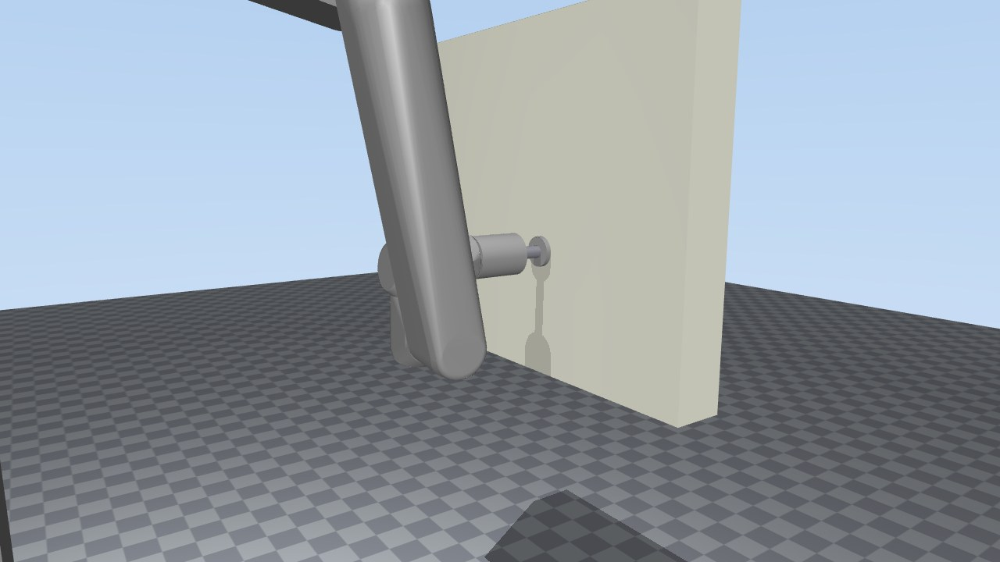
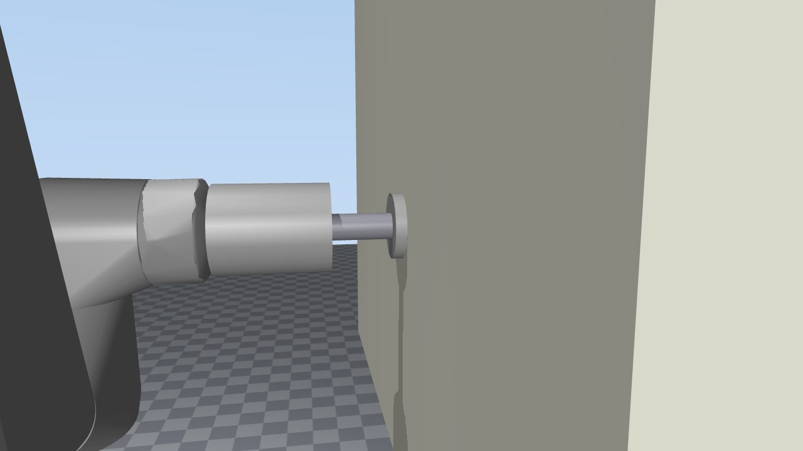

# Motion Planner

ROS 2 packages for covering a surface with a tool using a mobile manipulator: sensor data to coverage
plan, base stands, arm motion planning and execution on a compliant (admittance) controller with force
feedback. The target is a stack that works for any arm, lift and base (chosen by a robot profile) and any
tool (contact like a mop, non-contact like a spray gun), in simulation first and on hardware by parameters.

**Status in one line:** the building blocks exist and are tested, and both simulators now run the pipeline
end to end in headless one-command passes (coverage planner, manager, MoveIt, compliant controller, recorded
and scored). Nothing here has run on hardware, and the base does not yet move between stands in those passes.
The per-area checklist, with evidence for every item, is [docs/ROADMAP.md](docs/ROADMAP.md).

```
sensors -> perception -> self filter -> scene -> surface -> coverage (tool-aware) -> base stands
        -> navigation / docking -> motion planning -> execution (JTAC + F/T) -> monitoring
```

## Packages

Under `src/`, by area (layout rules: [docs/package_layout.md](docs/package_layout.md)).

| Area | Packages | What they do |
|---|---|---|
| Common | `core_types`, `ros_adapters`, `force_core` | ROS-free types and ports, conversions to ROS messages, the force-control core (contact state machine, wrench conditioning) |
| Description | `mobile_manipulator_description`, `mobile_manipulator_moveit_config`, `mobile_manipulator_profile` | Generic robot model (base + lift + N-DOF arm + tool, all swappable) with 13 profiles, MoveIt 2 config generated from a profile, header-only profile loader |
| Perception | `scene_model`, `scene_adapters`, `robot_self_filter`, `wall_detector`, `coverage_planner`, `coverage_planner_msgs` | Scene model (clouds, meshes, voxels, ESDF, loaders), scene to planner geometry, robot self filter (library and node), wall detection from a live point cloud, wall coverage planning (boustrophedon, sweepline, wall patterns, scan to plan) |
| Manipulation | `motion_planner`, `motion_planner_moveit`, `vamp_planner`, `curobo_bridge`, `curobo_bridge_msgs`, `curobo_planner`, `reachability`, `reachability_msgs`, `manipulation_manager`, `coverage_task_msgs` | Planner, IK, collision and scene ports; MoveIt/OMPL, VAMP and cuRobo v2 backends; RM4D reachability map and multi-stand planning; the manager that runs coverage, planning and execution |
| Control | `compliant_trajectory_controller`, `ft_bridge_hardware`, `ft_conditioner` | JTAC (admittance joint trajectory controller for `ros2_control`), F/T sensor bridge, wrench conditioning node |
| Simulation | `sim_mujoco`, `sim_gazebo`, `sim_isaac` | MuJoCo 4 and Gazebo Harmonic backends behind `hardware:=mujoco` / `hardware:=gazebo`; `sim_isaac` is a stub |

## Build and test (Docker)

The supported environment is the Docker image (ROS 2 Jazzy). From the repo root:

```bash
docker compose -f docker/compose.yaml build dev
docker compose -f docker/compose.yaml run --rm test     # colcon build + colcon test, no GPU
docker compose -f docker/compose.yaml run --rm dev      # interactive shell, repo mounted at /ws
```

Inside a shell: `docker/build.sh test` builds the workspace and prints the test summary. GPU targets
(`gpu`, `full`: cuRobo v2, VAMP) and the simulator images are described in [docs/docker.md](docs/docker.md).
Building outside Docker needs ROS 2, MoveIt 2, `ros2_control` and the packages in `docker/apt-extra.txt`.
The last full run recorded in the roadmap: 736 colcon tests in 26 packages, no failures. There is
deliberately no CI; [CONTRIBUTING.md](CONTRIBUTING.md) lists how to run every check locally.

## Showcase

A full MuJoCo manager pass on a plain wall (`run_manager_pass.sh`: coverage plan, dock, press, three stroke columns, retract),
rendered headless from the recorded joint states with `render_run.py`. The gif is the run at 9x, the
[mp4](docs/media/manager_pass.mp4) at 3x with a force trace.


| Robot overview | Arm at the wall, mid-stroke | Tool on the wall |
|---|---|---|
|  |  |  |


Scored result of the run shown (`score_run`, 10 N target, 1.5 N band): 3 columns done, 0 partial, 0 failed; coverage
93.1 % (866 of 930 cells); peak force 19.2 N; RMS force error 3.6 N; 49 % of the contact samples in the band; 144 s of
simulated time, 83 s engaged. While stroking, the force ripples between 0 and about 18 N around the 10 N target. Nothing is
tuned for the picture. The pass was run three times for filming: 93.1 % / 18.5 N / 3.6 N, 93.1 % / 19.2 N / 3.6 N (shown), and
a first run with 93.3 % / 153.4 N / 8.0 N, which was made while the host was heavily loaded by other simulations and builds
(load average 10 to 27); the cause was not isolated, but the two reruns on a quieter host agree with each other and with the standard run. How the media is made:
[docs/sim_mujoco.md](docs/sim_mujoco.md#rendering-photos-and-videos). The Gazebo scene is not shown: its launch has only a
depth camera and no colour camera to take a picture with.

## Simulators

Both run headless and sit behind `ros2_control`, so the same controllers run against them as against
hardware ([docs/simulation.md](docs/simulation.md)).

| | MuJoCo 4 (`sim_mujoco`) | Gazebo Harmonic (`sim_gazebo`) |
|---|---|---|
| Docs | [docs/sim_mujoco.md](docs/sim_mujoco.md) | [docs/sim_gazebo.md](docs/sim_gazebo.md) |
| Environment | `build` image with the MuJoCo SDK mounted (`MUJOCO_ROOT`); Python tools also in the `sim` image | `sim-gazebo` image |
| Can do today | Position and JTAC control of lift + arm, wall worlds from `wall_scene.json`, raw wrist F/T plus ground-truth contact wrench, conditioned force path, a 10 N contact test that holds (10.13 N for a 10 N target) | Same joint control and wall worlds, raw F/T plus ground truth, conditioned path validated against ground truth |
| Cannot do today | Move the base, simulate sensors | Hold 10 N in Gazebo (about 108 N was measured, cause not established; MuJoCo holds it), move the base, simulate sensors |

Isaac Sim is a stub.

## Quickstart: a simulated wall pass

Needs a built workspace (see above) with a sourced ROS environment; the MuJoCo scripts also need the MuJoCo SDK
(`MUJOCO_ROOT`, [docs/sim_mujoco.md](docs/sim_mujoco.md)), the Gazebo one needs the `sim-gazebo` image
([docs/docker.md](docs/docker.md)). Each script launches the sim headless, runs the pass, records it and scores it.

```bash
# MuJoCo: scripted wall strokes planned by MoveIt
bash $(ros2 pkg prefix sim_mujoco)/lib/sim_mujoco/run_wall_pass.sh
# MuJoCo: coverage planner -> manipulation_manager -> MoveIt -> JTAC
bash $(ros2 pkg prefix sim_mujoco)/lib/sim_mujoco/run_manager_pass.sh
# Gazebo Harmonic: the same manager pass (about 5 minutes)
bash $(ros2 pkg prefix sim_gazebo)/lib/sim_gazebo/run_manager_pass.sh
```

Sources: `src/simulation/sim_mujoco/scripts/`, `src/simulation/sim_gazebo/scripts/`.

## What you can run today

- MoveIt demo on the description with mock hardware: `ros2 launch mobile_manipulator_moveit_config demo.launch.py arm:=ur10e`
- Wall coverage planning from a scene file: `ros2 launch coverage_planner wall_coverage_demo.launch.py`
- Reachability map building and stand planning (`rm4d_tool`, `reachability_node`): [docs/reachability.md](docs/reachability.md)
- The simulated wall passes above, and the smoke and contact tests of each simulator

## Documentation

[docs/README.md](docs/README.md) is the index: [architecture](docs/architecture.md), [robot description](docs/robot_description.md),
[design principles](docs/design_principles.md), [decision records](docs/adr/). Third-party software and licences:
[THIRD_PARTY.md](THIRD_PARTY.md). Changes: [CHANGELOG.md](CHANGELOG.md). Contributing: [CONTRIBUTING.md](CONTRIBUTING.md).

## License

Apache License 2.0. See [LICENSE](LICENSE).
