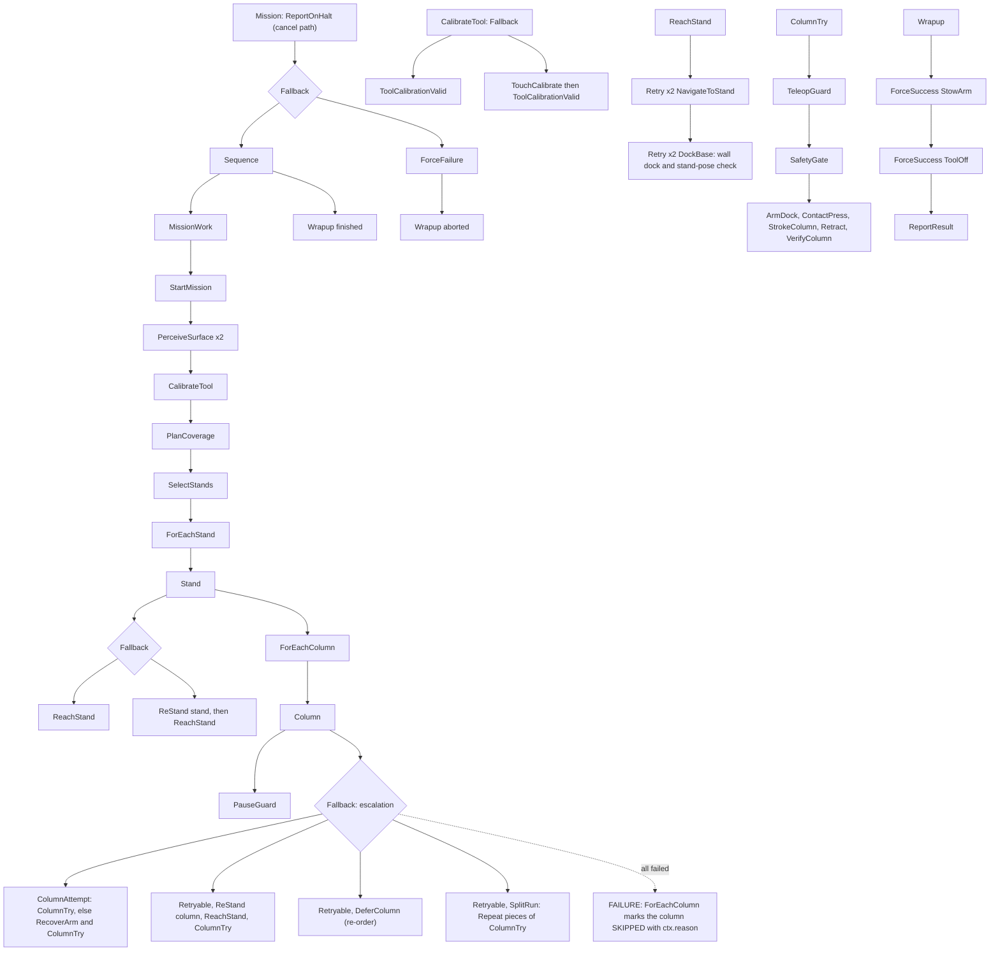

# Mission behaviour tree

Status: the whole expected behaviour of the stack is written as one BehaviorTree.CPP 4 tree with ROS-free node implementations behind abstract
ports. **The tree and node logic are tested on fake ports (host gtests). They are not wired to ROS, not connected to the manager, and have not run
in a simulator.** The manager still runs its hand-written flow; replacing it is the staged migration at the end of this page.

| File | What |
|---|---|
| `src/manipulation/manipulation_bt_prototype/trees/mission.xml` | the tree, BT.CPP 4 format, `TreeNodesModel` included |
| `.../include/manipulation_bt_prototype/mission_types.hpp` | failure reasons, port interfaces, `MissionCtx` (the shared state), report |
| `.../include/manipulation_bt_prototype/mission_nodes.hpp` | the node implementations and `registerMissionNodes()` |
| `.../include/manipulation_bt_prototype/mission_fakes.hpp` | scripted fakes of every port |
| `.../test/mission_tree_test.cpp` | 53 gtests over the fakes |

The older reduced prototype (`bt_prototype.hpp`, `prototype_mission.xml`) is unchanged; the new code lives in the C++ namespace
`manipulation_bt::mission`. The evaluation and the decision to adopt later are in [../behavior_tree_evaluation.md](../behavior_tree_evaluation.md).

## 1. The tree

Reading rules
- `FAILURE` of the `Stand` subtree means the stand is skipped; `FAILURE` of the `Column` subtree means the column is skipped as the last resort. Both loops
  turn that into ledger entries (`SKIPPED` plus the reason) and go on. A loop returns `FAILURE` only when a guard requested a mission abort.
- Always-report: `Fallback(Sequence(work, Wrapup finished), ForceFailure(Wrapup aborted))`. `Wrapup` is `StowArm`, `ToolOff`, `ReportResult`;
  the first two are under `ForceSuccess` so a refused stow never blocks the report. `ReportResult` publishes at most once per run (`MissionCtx::reportOnce`).
  A cancel does not tick anything, so `ReportOnHalt` (root decorator) publishes the `canceled` report from its `halt()` after its child has been halted.
- Escalation order of a column follows the development plan section 4: one attempt and one retry (after `RecoverArm`), re-stand, re-order, split, skip.
  `Retryable` stops the ladder for causes no attempt cures (contact overload, safety or teleop timeout, calibration, cancel). A re-ordered column is
  visited again at the end of its stand and repeats the cheap steps, because its seed state differs; a second re-order is refused, so the split or the skip follows.
- Policy numbers are literals in the XML on purpose (`nav_attempts` 2, dock attempts 2, one column retry, safety timeout 30 s, teleop timeout off): they are the
  manager parameters of today, and changing them needs no recompile.

## 2. Shared state ("blackboard keys") and failure reasons

The shared state of a mission is one typed struct, `MissionCtx`, handed to every node when its type is registered (`registerMissionNodes(factory, ctx)`). It
is not stored on the BT blackboard: a BT.CPP subtree has its own blackboard, so a ctx entry would need port remapping through every subtree. Node
parameters that belong to the XML (`scope`, `outcome`, `timeout_s`, `pieces`) are ordinary BT ports. When the ROS wiring needs the values on the blackboard (a
tree logger, Groot), a node can mirror them with `setOutput`.

| Field of `MissionCtx` | Type | Written by | Read by | Meaning (existing manager concept) |
|---|---|---|---|---|
| `ports.*` | shared_ptr of the 11 port interfaces | host | all leaves | the executors |
| `fsm` | `MissionFsm` (core, unchanged) | `StartMission`, `RecoverArm`, host | `PauseGuard`, `ReportResult` | mission IDLE / ACTIVE / PAUSED / STOPPED / RECOVERY |
| `ledger` | `MissionLedger` (core, unchanged) | `PlanCoverage`, loops | loops | per column PENDING / RUNNING / DONE / SKIPPED / FAILED |
| `mission_id`, `resume`, `wanted_columns` | string, bool, vector | host | `PlanCoverage`, `SelectStands` | ExecuteCoverage `resume`, `columns` |
| `plan`, `stands` | `CoveragePlan`, `vector<StandPlan>` | `PlanCoverage`, `SelectStands`, `ReStand` | loops, nav, dock | coverage plan, `plan_stands` result (stand: id, pose, columns, margin) |
| `stand`, `column`, `piece`, `pieces` | indices | loops, `SplitColumn`, `NextPiece` | leaves | current stand index, column (ledger segment), piece of a split column |
| `reason` | `Reason` | failing leaves | `Retryable`, loops | reason of the last failure in the current stand or column (`column_reason_`) |
| `abort_requested`, `abort_reason` | bool, `Reason` | `SafetyGate`, `TeleopGuard` | loops, `Retryable`, `StowArm` | mission-ending guard |
| `column_deferred`, `columns_after`, `deferred` | bool, size, set | `DeferColumn`, `ForEachColumn` | `ForEachColumn`, `DeferColumn` | re-order bookkeeping |
| `report`, `report_sent` | `MissionReport`, bool | loops, guards, `reportOnce` | `ReportResult` | ExecuteCoverage result plus counters |
| `events` | `vector<string>` | nodes and fakes | tests | ordered log of node and port calls |
| `clock` | `function<double()>` | host (tests inject) | guards | seconds, for the timeouts |

Failure reasons (`Reason`). The first five are the manager's `SkipReason`; each reason maps onto a `SkipReason` for the ledger (`toSkipReason`) and the
report keeps the full reason.

| Reason | Ledger `SkipReason` | Retryable | Raised by |
|---|---|---|---|
| `NAV_FAILED` | NAV_FAILED | yes | `NavigateToStand` (after the retry decorator) |
| `DOCK_FAILED` | DOCK_FAILED | yes | `DockBase` |
| `PLAN_FAILED` | PLAN_FAILED | yes | default of a column failure that gives no reason; arm leaves; `PlanCoverage` |
| `CONTACT_OVERLOAD` | CONTACT_OVERLOAD | no | the arm port (it owns the force threshold, as the manager's `contact_overload_n_`) |
| `PERCEPTION_FAILED` | PLAN_FAILED | yes | `PerceiveSurface` |
| `STAND_CHECK_FAILED` | DOCK_FAILED | yes | `DockBase`: achieved pose error above the stand's margin |
| `VERIFY_FAILED` | PLAN_FAILED | yes | `VerifyColumn` |
| `SAFETY_TIMEOUT` | PLAN_FAILED | no, aborts | `SafetyGate` |
| `TELEOP_TIMEOUT` | PLAN_FAILED | no, aborts | `TeleopGuard` |
| `CALIBRATION_INVALID` | PLAN_FAILED | no | `ToolCalibrationValid`, `TouchCalibrate` |
| `NO_STANDS` | PLAN_FAILED | no | `SelectStands` |
| `CANCELED` | none | no | `ReportOnHalt` |

Partial columns (the manager's `ColumnOutcome::kPartial`, ledger `FAILED`, rerun on resume) are not modelled yet: the arm port reports done or failed. A third
outcome needs a flag on `MissionCtx` read by `ForEachColumn`, as the evaluation noted.

## 3. Ports

Long operations are `start` + `poll` (+ `cancel`) so a leaf can be a `StatefulActionNode`; a tick never blocks on them. Planning calls are short and blocking.

| Port | Calls | Real adapter later |
|---|---|---|
| `PerceptionPort` | `startScan`, `poll`, `cancel` | wall detector / scene service |
| `PlannerPort` | `planCoverage`, `selectStands`, `alternateStand`, `standForColumn`, `splitColumn`, `replanFromPose` | coverage JSON load, reachability `plan_stands`, column planner |
| `NavigationPort` | `startNavigate(stand)`, `poll`, `cancel` | `stand_navigator` `NavigateToStand` action |
| `DockPort` | `startDock(stand)`, `poll` (value: pose error m), `cancel` | `WallDock` |
| `ArmMotionPort` | `start(phase, column, piece)` for approach, press, stroke, retract, stow, recover; `poll`; `cancelTrajectory`, `admittanceOff`, `forceTargetZero`; `hold`, `resume`, `setSpeedScale`; `peakForceN` | JTAC execution adapter, tool actuation node, `abortCleanup()` split into its steps |
| `VerifyPort` | `startVerify`, `poll` (value: covered fraction), `cancel` | verify service |
| `SafetyPort` | `read()` speed scale, stop request, freshness | `/safety/speed_scale`, `/safety/stop_request` |
| `TeleopPort` | `mode()` AUTO/TELEOP/HOLD, `takeConfirm()`, `toolPose()`, `onHandoverStarted()` | teleop bridge mode manager |
| `CalibrationPort` | `record()`, `startTouch`, `poll`, `cancelTouch` | tool calibration record and touch stage |
| `ToolPort` | `contact()`, `off()`, `closeValve()` | tool actuation |
| `ReportSink` | `publish(report)`, `state(string)` | action result and feedback |

## 4. Node catalogue

"Ports" are BT XML ports; everything else is `MissionCtx` (section 2). "Today" is the manager function the node replaces; "Plugs in" is the later
feature that needs it (development plan section numbers).

| Node | Type | Ports | Reads / writes | Failure codes | Today | Plugs in |
|---|---|---|---|---|---|---|
| `ReportOnHalt` | decorator | | writes `reason`, `report` | | `stop()`, cancel path of the handler | |
| `StartMission` | action | | `fsm`, resets per-run state | | handler start, `mission_fsm_.start()` | |
| `PerceiveSurface` | stateful action | | `PerceptionPort` | PERCEPTION_FAILED | wall detector call before planning | s2 plane-generic |
| `ToolCalibrationValid` | condition | | `ToolPort`, `CalibrationPort` | CALIBRATION_INVALID | none (no stage today) | s11 calibration record validity |
| `TouchCalibrate` | stateful action | | `CalibrationPort`, safe state on halt | CALIBRATION_INVALID | none | s11 `planeTouchCalibration`, calibration stage |
| `PlanCoverage` | action | | `plan`, `ledger.begin(mission_id, n, resume)` | PLAN_FAILED | load coverage JSON, `ledger_.begin` | |
| `SelectStands` | action | | `stands`, `wanted_columns` | NO_STANDS | `plan_stands` call, `assignColumnsToStands` | s6 base placement |
| `ForEachStand` | control | | `stand`, `report.stands`, ledger | NAV_FAILED default on skip | `runStands` loop, `TaskTracker` stand outcome | |
| `ReachStand` | subtree | | | | `NavVerdict` retry/skip, `runStands` | |
| `NavigateToStand` | stateful action | | `NavigationPort` | NAV_FAILED | `NavigateToStand` client, `nav_attempts` | s7 Nav2 `NavigateToPose` |
| `DockBase` | stateful action | | `DockPort`, stand margin | DOCK_FAILED, STAND_CHECK_FAILED | `WallDock` call plus `StandCheck::evaluate(achieved, reach_margin_m, redocks_done)` (`core/stand_check.hpp`, #169: go / re-dock / abort, `max_redocks`, margin-derived tolerance); the tree's `Retry x2 DockBase` is that re-dock budget (`max_redocks` 1) and the node's margin compare stands in for `toleranceM` | s7 metrics harness, lateral term |
| `ReStand` | action | `scope` stand/column | `stands[stand]`, `PlannerPort` | none (keeps the earlier reason) | none | s4 re-stand, s7 alternate-stand policy |
| `ForEachColumn` | control | | `column`, `piece`, ledger, `report` | PLAN_FAILED default | `runColumnWithRetry` ledger handling | |
| `PauseGuard` | stateful action | | `fsm` | | `atBoundary()` wait in `runColumnWithRetry` | |
| `ColumnAttempt` | subtree | | | | `runColumnWithRetry` retry loop (`column_retries_`) | |
| `RecoverArm` | stateful action | | `fsm` RECOVERY, `ArmMotionPort` (recover), safe state | PLAN_FAILED | `recoverArm()` between retries | s5 joint limits |
| `Retryable` | condition | | `reason`, `abort_requested` | | `overloaded()` test | |
| `DeferColumn` | action | | `deferred`, `columns_after`, `column_deferred` | | none | s4 re-order |
| `SplitColumn`, `NextPiece`, `SplitRun` | action, action, subtree | out `pieces` | `PlannerPort`, `pieces`, `piece` | | none | s4 split as last resort |
| `ColumnTry` | subtree | | | | `runColumn` | |
| `TeleopGuard` | decorator | `timeout_s` | `TeleopPort`, `PlannerPort`, `report` | TELEOP_TIMEOUT | none | s8 teleop bridge AUTO/TELEOP/HOLD |
| `SafetyGate` | decorator | `timeout_s` | `SafetyPort`, `ArmMotionPort` | SAFETY_TIMEOUT | none (abort on contact threshold only) | s9 safety monitor |
| `ArmDock` | stateful action | | `ArmMotionPort` approach | PLAN_FAILED or port reason | dock pose step of `runColumn`; the adapter picks the joint goal with `selectDockIk` (`core/dock_ik_selector.hpp`, opt-in branch continuity, #169) | s4 `ColumnIkChain` (`reachability/core/column_ik_chain.hpp`, #166) behind `PlannerPort::splitColumn` / `standForColumn`, s5 |
| `ContactPress` | stateful action | | `ArmMotionPort` press, `ToolPort` | port reason, CONTACT_OVERLOAD | press step, admittance engage | s3 offset and tilted tools, s10 diff-IK |
| `StrokeColumn` | stateful action | | `ArmMotionPort` stroke | same | stroke execution through the JTAC adapter | s10, s11 online tool correction |
| `Retract` | stateful action | | `ArmMotionPort` retract | same | retract step | |
| `VerifyColumn` | stateful action | | `VerifyPort` | VERIFY_FAILED | none as a column gate (verify is separate) | s0 scoring measures the tool |
| `StowArm` | stateful action | | `ArmMotionPort` stow | PLAN_FAILED; refused after SAFETY_TIMEOUT | `StowForDrive` / end stow | |
| `ToolOff` | action | | `ToolPort` | | `abortCleanup()` tool part | |
| `ReportResult` | action | `outcome` | `report`, `ledger`, sink | | result assembly in the handler | |
| `Mission`, `MissionWork`, `CalibrateTool`, `Stand`, `Column`, `Wrapup` | subtrees | | | | the handler and `runStands` | |

## 5. Cross-cutting guards

- **PauseGuard** at the start of every column. The FSM turns a requested pause into PAUSED only here (`atBoundary()`); the guard stays RUNNING until `resume`. A
  pause never cancels the segment in flight (tested).
- **SafetyGate** around the arm motion of a column try. Every tick: read `SafetyPort`; pass `speed_scale` (clamped to 0..1) to `ArmMotionPort`. A stop request or stale data
  calls `hold()` once, stops ticking the child and stays RUNNING, so the motion cannot continue while the stop stands, not even to start. When the stop clears, `resume()` and the
  same motion goes on (no restart). A stop longer than `timeout_s` halts the child (cleanup contract below), sets `SAFETY_TIMEOUT` and the abort flag; the mission ends through `Wrapup aborted`, whose stow is
  refused (the stop still stands). Stale data counts as a stop, so a dead monitor fails safe.
- **TeleopGuard** around the same body, outside the safety gate. Any mode other than AUTO halts the running child at once (cleanup contract) and the node keeps RUNNING. Returning to AUTO is not enough: nothing
  runs until `takeConfirm()` (a confirm given earlier, while still in TELEOP or HOLD, is discarded). Then the planner re-plans the current column from `toolPose()` and the child restarts from
  its beginning (approach included). `timeout_s` (off by default) aborts the mission with `TELEOP_TIMEOUT`.
- **CalibrateTool** at mission start, after the scan. A non-contact tool needs nothing. A contact tool passes with a valid record; otherwise the touch sequence runs once and its result must
  make the record valid. A failing touch or a record that stays invalid aborts the mission before any stand is driven to (`CALIBRATION_INVALID`). Removing the second branch of the subtree
  makes a pre-calibrated tool mandatory.
- **Retryable** keeps contact overload, safety and teleop timeouts, calibration and cancel out of the retry and escalation ladder.

## 6. Cancel and cleanup contract

`tree.haltTree()` (what the action cancel callback would call) halts the root; every running node's `halt()` / `onHalted()` runs, parents before children are reset, the running leaf cleans up, and
`ReportOnHalt` then publishes `canceled` once and stops the FSM.

A leaf that drives the arm (`ArmDock`, `ContactPress`, `StrokeColumn`, `Retract`, `StowArm`, `RecoverArm`, `TouchCalibrate`) cleans up the same way when it is halted **and** when it fails, in this order
(`MissionCtx::safeState`, the manager's `abortCleanup()` split into its steps):

1. cancel the trajectory (`ArmMotionPort::cancelTrajectory`)
2. tool off (`ToolPort::off`)
3. admittance off (`ArmMotionPort::admittanceOff`)
4. force target zero (`ArmMotionPort::forceTargetZero`)
5. valve closed (`ToolPort::closeValve`)

Leaves that do not drive the arm cancel their own operation (navigation, dock, scan, verify). A halted column stays RUNNING in the ledger so a resume reruns it (as today). The order is asserted in the tests on the
event log for cancel, safety timeout, teleop handover and a failed leaf. Not covered: an exception thrown by a port bypasses the fallbacks (evaluation section 2); adapters must catch their own.

## 7. What is stubbed or not modelled

- Every port: only fakes exist. No ROS, no real timing, no action latency, no tick-rate measurement.
- Partial column outcome, `PrimeScene` / octomap refresh, controller switching (position to contact and back), the manager's `last_good_state_` bookkeeping and the jog recovery itself (the port
  gets one `recover` call).
- Teleop and safety guards wrap column tries only: a stop or handover during navigation or docking is not handled by the tree (the navigation stack stops itself).
- Re-planning after a teleop handover is one planner call; what it computes is the planner's job.
- Splitting runs the pieces inside one ledger column; the ledger has no per-piece state.
- Stand re-assignment keeps the stand's other columns on the new pose; the planner decides whether they remain reachable (they fail and escalate on their own if not).
- A multi-goal queue and per-app goal kinds (development plan: one job at a time) are outside this tree.

## 8. Migration plan from the hand-written flow

Each step keeps the previous behaviour and is checked by the sim passes that exist today (`run_manager_pass.sh`, the multi-stand, pause, resume and jog-recovery runs; numbers to
match: coverage 0.931, peak 19.97 N, RMS 3.61 N in the single-stand pass). Do not start a step until the previous one passes.

1. **BT host, one leaf.** A new node file in `manipulation_manager` (ROS side) runs the tree with a single `RunColumn` ArmMotionPort adapter that calls today's `runColumn`. Flow, ledger, retry and
   cancel stay as they are; the tree only replaces the stand and column loops and the pause guard. Check: single-stand and multi-stand passes identical, pause and resume run identical.
2. **Real Navigation, Dock, Perception, Planner ports** over the existing clients and services. Check: multi-stand pass, a forced `NAV_FAILED` stand skip.
3. **Peel the column into ArmMotionPort phases** (approach, press, stroke, retract) over the JTAC adapter and tool actuation; keep `abortCleanup()` as the five cleanup calls. Check: the full pass and the cancel-mid-column check
   (trajectory, admittance, force target, valve).
4. **Retry and recovery as XML**: `ColumnAttempt`, `RecoverArm`, `Retryable` replace `runColumnWithRetry`'s loop. Check: the jog-recovery run and a contact-overload run (skipped without retry).
5. **Resume and ledger** through `PlanCoverage` / loops. Check: the restart-and-resume run.
6. **ReportResult and feedback strings** produce the action result. Check: result fields equal the old ones on the passes above.
7. **Guards**, each only when its source exists: `SafetyGate` with the safety monitor (development plan s9), `TeleopGuard` with the teleop bridge (s8), `CalibrateTool` with the calibration record (s11),
   `DockBase` stand check with its metrics harness (s7), escalation steps with `ColumnIkChain` / reachability (s4).
8. **Delete the hand-written flow** (`TaskStateMachine`, the run loop) once steps 1 to 6 pass on the sim. `MissionFsm`, `MissionLedger` and `TaskTracker` stay.

Dependencies for the ROS side: BehaviorTree.ROS2 is still not packaged for Jazzy (evaluation section 1); the action leaves are written on `StatefulActionNode` over the ports above, as here.
