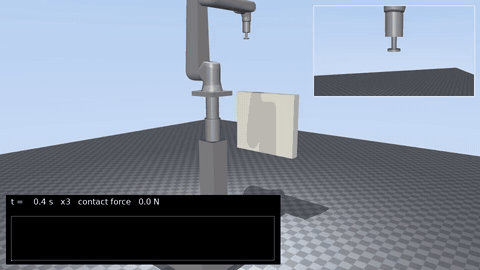
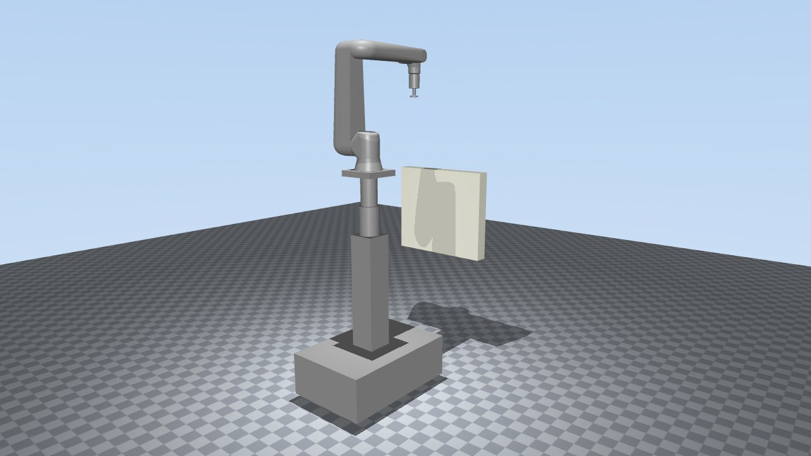
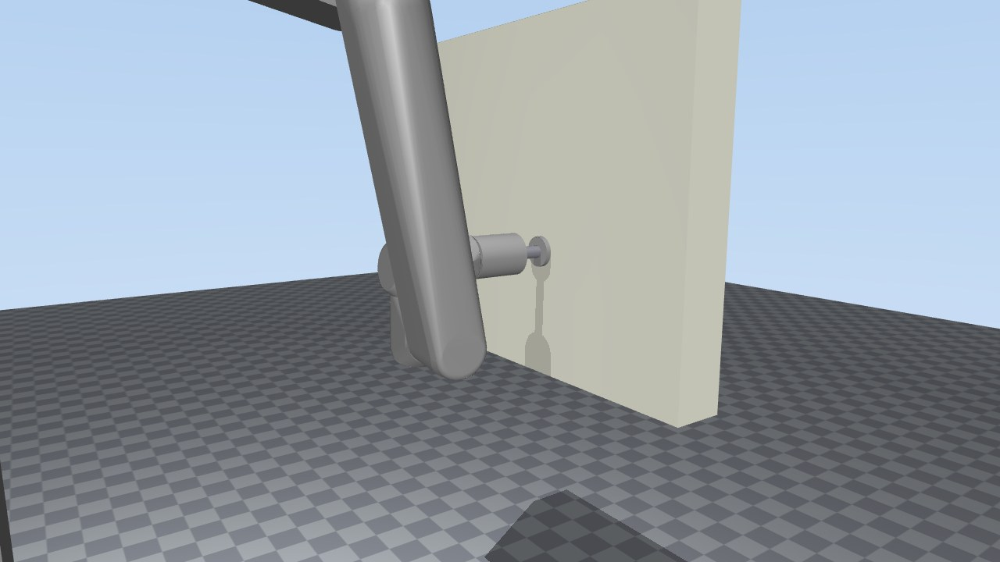
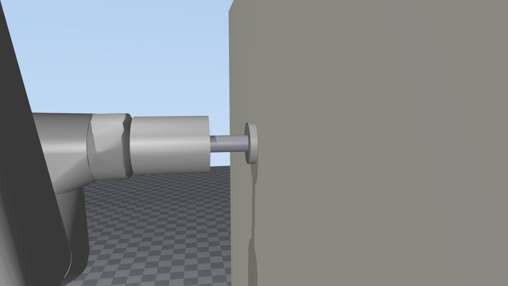
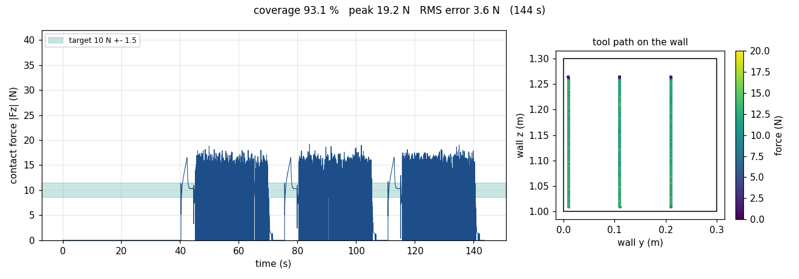
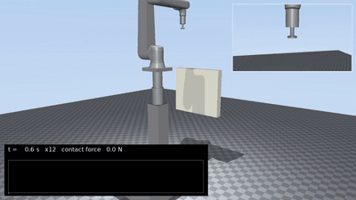
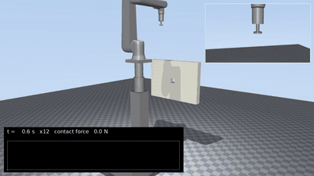
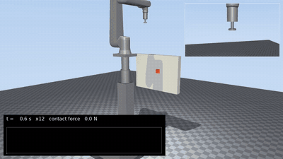
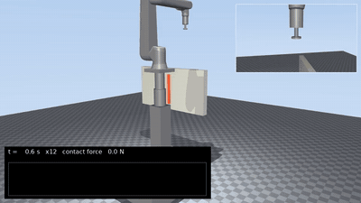

# MuJoCo simulation backend (`sim_mujoco`)

A headless physics backend for the mobile manipulator under ros2_control, built against the new
MuJoCo 4.x C SDK (tested with 4.0.1). It is `hardware:=mujoco` in the description's ros2_control
xacro, next to `mock` and `jtac_mock`. Package: [`src/simulation/sim_mujoco`](../src/simulation/sim_mujoco).

| Part | What it is |
|---|---|
| `sim_mujoco/MujocoSystemInterface` | C++ ros2_control `SystemInterface` plugin (pluginlib). Loads an MJCF, steps MuJoCo by the controller period in `write()`. |
| `MujocoSim` | ROS-free core under the plugin (joint commands in, joint state and wrenches out); gtest-covered. |
| `sim_mujoco.mjcf_generator` | URDF to MJCF (pure Python, standard library only). |
| `sim_mujoco.wall_world` | `wall_scene.json` / `scene_model` scene / cuRobo world to MuJoCo geoms. |
| `launch/sim_mujoco.launch.py` | profile -> xacro -> MJCF -> controller_manager + plugin + controllers. Headless. |
| `scripts/smoke_test.py`, `run_smoke.sh` | trajectory-following and wall-contact smoke test. |
| `scripts/contact_test.py`, `run_contact.sh` | contact-controlled test of the full force path (conditioner, bridge, JTAC). |

## Showcase



A full manager pass on a plain wall (`run_manager_pass.sh`), rendered by `render_run.py`. The gif is the run at 9x, the
[mp4](media/manager_pass.mp4) at 3x with a force trace.


A spray pass (`run_spray_pass.sh`, [mp4](media/spray_pass.mp4)), same renderer; the cone and the wall spots are drawn from the valve
log. Scored run shown: 3 columns done, coverage 1.0 (930 of 930 cells), thickness CoV 0.52, valve open 15.6 s of 94.2 s, whole-run
peak force 0.0 N ([Spray pass](#spray-pass-non-contact-tool)).

| Robot overview | Arm at the wall, mid-stroke | Tool on the wall |
|---|---|---|
|  |  |  |



Scored result of the run shown (`score_run`, 10 N target, 1.5 N band): 3 columns done, 0 partial, 0 failed; coverage
93.1 % (866 of 930 cells); peak force 19.2 N; RMS force error 3.6 N; 49 % of the contact samples in the band; 144 s of
simulated time, 83 s engaged. While stroking, the force ripples between 0 and about 18 N around the 10 N target. Nothing is
tuned for the picture. The pass was run three times for filming: 93.1 % / 18.5 N / 3.6 N, 93.1 % / 19.2 N / 3.6 N (shown), and
a first run with 93.3 % / 153.4 N / 8.0 N, which was made while the host was heavily loaded by other simulations and builds
(load average 10 to 27); the cause was not isolated, but the two reruns on a quieter host agree with each other and with the standard run. How it is made: [Rendering photos and videos](#rendering-photos-and-videos).

## Build

The SDK is not vendored. Download the tarball of the release and point `MUJOCO_ROOT` at it:

```bash
curl -L -o mujoco.tgz https://github.com/google-deepmind/mujoco/releases/download/4.0.1/mujoco-4.0.1-linux-x86_64.tar.gz
mkdir -p /opt/mujoco-sdk && tar xzf mujoco.tgz -C /opt/mujoco-sdk       # -> /opt/mujoco-sdk/mujoco-4.0.1
export MUJOCO_ROOT=/opt/mujoco-sdk/mujoco-4.0.1
colcon build --packages-select sim_mujoco mobile_manipulator_description
```

No SDK download is needed when the `sim` image's Python wheel is at hand: `mujoco-core` ships `libmujoco.so.4.0.1` and the
headers, so a `MUJOCO_ROOT` can be assembled from it (`include/` copied from `site-packages/mujoco/include`, `lib/libmujoco.so.4.0.1`
plus a `libmujoco.so` symlink). This is how the contact test was run on a machine with a slow link to GitHub.

Without `MUJOCO_ROOT` (or `/opt/mujoco`) CMake prints a warning and builds only the Python tools,
launch files and data, so the repo-wide `colcon build` of the `build` image stays green. With it,
`libmujoco.so.4.0.1` is installed next to the plugin (`$ORIGIN` rpath), so the install tree is
self-contained. No new Docker image: the `build` image (ROS Jazzy) builds and runs it with the
SDK mounted, e.g. `-v <sdk>/mujoco-4.0.1:/opt/mujoco:ro -e MUJOCO_ROOT=/opt/mujoco`. The pure-Python
tests also run in the `sim` image (it has the `mujoco-core` 4.0.1 Python package).

## Run

```bash
ros2 launch sim_mujoco sim_mujoco.launch.py profile:=ur10e_telescopic \
    scene:=$(ros2 pkg prefix sim_mujoco)/share/sim_mujoco/data/smoke_wall_scene.json
ros2 launch sim_mujoco sim_mujoco.launch.py controller:=jtac     # compliant controller
ros2 launch sim_mujoco sim_mujoco.launch.py controller:=jtac conditioner:=true   # + ft_conditioner, JTAC on the conditioned wrench
ros2 launch sim_mujoco sim_mujoco.launch.py viewer:=true         # optional, needs a display
ros2 run sim_mujoco generate_mjcf --profile ur10e_telescopic --out /tmp/mj --scene wall_scene.json \
    --scene-offset 0.6 0 0 0                                    # model only, no ROS graph
```

The launch file renders the URDF from the profile (`xacro_args`), generates the MJCF into a temp
dir (`out_dir:=` to keep it), exports its path as `SIM_MUJOCO_MJCF` (read by the xacro
`<param name="mjcf">$(optenv SIM_MUJOCO_MJCF)</param>`), renders `robot_description` with
`hardware:=mujoco` and starts `ros2_control_node`, `robot_state_publisher`, the
`joint_state_broadcaster` and a controller named `combined_arm_lift_controller` (the name MoveIt's
controller config uses). `controller:=jtc` is a `JointTrajectoryController` (position command);
`controller:=jtac` loads `compliant_trajectory_controller/JtacController` from the repo's own
`jtac_controller.yaml`, overriding the joint names, the kinematics chain (`frames.base` to
`frames.tcp`), the F/T sensor name and frames from the profile. Joint names always come from the profile.

What `controller:=jtac` compensates. The plugin's `ft_sensor` is the raw wrench at `tool_mount_link` in
the sensor axes, with the tool weight. The launch therefore sets the sensor frame and the gravity
compensation frame to `tool_mount_link` (the control frame stays the TCP) and fills JTAC's
`gravity_compensation.CoG` from the URDF: force = tool mass x 9.81, position = tool centre of gravity in
the mount frame. So the tool weight is removed. Not compensated: the sensor bias (use `ft_tare`) and the
lever arm from the sensor to the TCP, because JTAC only rotates the wrench into the control frame
(see [ft_sensing.md](ft_sensing.md)); a contact force at the TCP therefore shows a torque error of
`r x F` (r = 0.165 m). Engage force axes only. Torque axes need a conditioner in front of JTAC.

If several ROS 2 containers share a host, give the sim its own `ROS_DOMAIN_ID` (and
`ROS_AUTOMATIC_DISCOVERY_RANGE=LOCALHOST`): containers on one Docker bridge discover each other,
and another stack's controller_manager will answer your spawners.

## Interfaces

Per joint (profile order: lift, then the six arm joints): command `position`, `velocity`; state
`position`, `velocity`, `effort` (applied actuator force after the force-range clamp). The mimic
lift stages are an MJCF `<equality><joint>` constraint, not commanded. `initial_value` of the
position state interface sets the start pose (the xacro's home pose). A position command of NaN
holds the last target, a NaN velocity counts as zero; on activation the commands are set to the
start pose.

Command law: one MuJoCo position actuator per joint with `kp = 10 * effort_limit` (N m/rad) for
revolute and `100 * effort_limit` (N/m) for prismatic joints, `kv = 0.1 kp`, force range = effort
limit. The plugin applies `ctrl = q* + kv/kp * v*`, which is exactly the PD law
`kp (q* - q) + kv (v* - qdot)`: velocity feed-forward without a second actuator. Arm links and the
lift are gravity compensated (`gravcomp`), so the PD holds poses; everything beyond the F/T site
is not (see below). Joint damping and armature are small defaults (2 N m s/rad plus
`0.0005 * effort`; lift 100 N s/m and 2 kg) chosen so the implicit-fast integrator stays stable at
2 ms and a 100 Hz controller.

## Tool force/torque

Modelled like a real wrist sensor, nothing is pre-compensated:

- MJCF site `ft_sensor` at the wrist (origin of `tool_mount_link`, between the arm flange and the
  tool) with a MuJoCo force and torque sensor. The tool is physically offset: the TCP is
  `tcp_xyz` (0.165 m) along z, and a thin contact pad sits at the TCP so a wall touch happens where
  coverage poses are defined.
- ros2_control sensor `ft_sensor` with state interfaces `force.x .. torque.z` (the shape
  `ft_bridge_hardware` exports and JTAC reads), in the **sensor frame**, and the same raw wrench as
  `geometry_msgs/WrenchStamped` on `/sim_mujoco/ft_raw`.
- **Measured sign convention.** MuJoCo's site force sensor is multiplied by -1 in the plugin. The
  result is the force the tool side puts on the sensor: `F = F_env + m g (+ inertia)` for
  everything beyond the sensor, torque about the sensor origin. A tool hanging at rest reads
  `(0, 0, -m g)` when the sensor z axis points up. `test_mujoco_sim.cpp` (`WeightAndPush`) measures
  both a known weight and a known push; the smoke test checks it on the UR10e (0.5 kg tool reads
  4.91 N). The weight of the tool is deliberately kept (bodies beyond the sensor are not gravity
  compensated); a downstream conditioner has to remove payload gravity, the lever arm to the TCP
  and the bias.
- **Ground truth (evaluation only):** `/sim_mujoco/ft_ground_truth`, `mj_contactForce` summed over
  contacts between the tool subtree and anything else, the wrench the environment exerts on the
  tool, referred to the TCP and expressed in the tcp frame (`force_z ~ -push` when pressing along
  tool +z). Control must not read it.
- Hardware parameters: `mjcf`, `ft_site`, `tcp_site`, `ft_frame_id`, `tcp_frame_id`, `ft_tare`.

## MJCF generator

`urdf_to_mjcf` converts the URDF of the profile's robot. Bodies, joints, origins, axes, limits and
inertials are carried over (full inertia tensors are rotated into the link frame; checked against an
independent hand-written FK). Collision geometry only: boxes, cylinders and spheres stay primitives,
STL/OBJ meshes are copied next to the MJCF (`meshes/`) and referenced as assets with `maxhullvert=64`.
MuJoCo collides meshes as their convex hull, so there are no separate hull files. Neighbouring links
within 2 joints of each other get `<contact><exclude>` pairs (the same rule the other collision
checkers use; welded links form one rigid group), because the UR meshes overlap at the joints.
Home pose becomes a `home` keyframe in MuJoCo's depth-first qpos order.

The wall world (`wall_world.py`) reads the files the coverage planner reads: `wall_scene.json`
(each wall becomes a box whose front face lies on the scanned plane and which extends 0.1 m behind
it; obstacles become oriented boxes), a `scene_model` native scene (box, sphere, cylinder, capsule,
roles) or a cuRobo world dict. Meshes and point clouds are skipped and reported. Walls and
`contact_surface` objects get friction 1.0. `--scene-offset x y z yaw` places the scene in the robot
base frame (scans are in the mapping frame, not the robot's).

## Smoke test

`scripts/run_smoke.sh` launches the UR10e + `smoke_wall_scene.json` (wall plane x = 0.98 m, tool axis
+x) and runs `smoke_test.py`: trajectory home -> pre-contact pose, `/joint_states` reach it and pass
through the midpoint; in free space ground truth is 0 and raw reads the 4.9 N payload; a 5 cm push
past the wall gives a negative tool-z force of a few hundred N at most, mostly along the tool axis;
the raw wrench equals ground truth plus payload plus lever arm (`tau_s = tau_tcp + r x F + tau_payload`,
`r = (0, 0, tcp_z)`) within 8 %; the force goes away on retreat. Last run with `jtc`: all checks pass
(Fz = -208 N, raw/truth difference 0.05 N, 0.00 N m). With `jtac` (no admittance axes selected, so
it passes the reference through) the same run passes too; the retreat check waits for the force to vanish
(quiet for 0.5 s, 8 s allowed) and prints how long that took: 0 s with `jtc`, about 3 s with `jtac` (see
"Retreat" below). The poses were solved with a damped-least-squares IK on the generated model; they are
UR10e-specific.

### Retreat: why JTAC leaves a residual for about 3 s

Earlier versions of the smoke test looked 1.5 s after the retreat trajectory ended and, with `jtac`, found
13.8 N still on the tool. It is not the simulator. Measured over the retreat (press 5 cm past the wall, then
back to a pose 3 cm short of it; wall plane x = 0.98 m, tool axis +x; the JTAC `~/debug_offset` topic gives
the reference and the commanded tool position):

| t after retreat start | reference x | commanded x (reference + compliance offset) | ground-truth Fz |
|---|---|---|---|
| 0 s | 1.030 | 1.127 | -47 N |
| 4 s (trajectory ends) | 0.950 | 1.022 | -22 N |
| 5 s | 0.950 | 1.008 | -14 N |
| 6 s | 0.950 | 0.996 | -12 N |
| 7 s | 0.950 | 0.983 | 0 |
| 8 s | 0.950 | 0.971 | 0 |

- The force is not simulator hysteresis: with `jtc` the same retreat gives 0 N at once, and the force goes
  to exactly zero (not a tail) the moment the commanded x crosses the wall plane (0.98 m, at about 7 s).
  There is no tare (`ft_tare` off), and the tool is not stuck: the joints follow the command.
- It is the JTAC compliance offset. The ros2_controllers admittance rule integrates a mass-spring-damper on
  the tracking error and only masks the *force* by `selected_axes`; the spring acts on every axis. While the
  wall blocked the tool the rule accumulated a 0.10 m offset (commanded 10 cm past the reference), which
  is also why the push is 50 N and not the 208 N of `jtc`. When the reference leaves, the offset relaxes
  with the over-damped time constant D/K (about 2 s for the Z gains of `jtac_controller.yaml`), so the
  commanded pose is still inside the wall about 3 s after the trajectory ended.
- Consequence for tests and for coverage sequencing: after a contact segment, wait for the offset to relax
  (about 3 time constants) or reset it before relying on "no contact", and do not treat a JTAC retreat as
  instantaneous. With a force target and the axis engaged (contact test below) the offset is small, and the
  force is released as the trajectory ends (4.1 s after its start).
- Not changed in the simulator: nothing in `sim_mujoco` was wrong. A fix would be in JTAC (reset the
  admittance state on disengage); left alone here.

## Contact-controlled test (full force path)

`scripts/run_contact.sh` launches `controller:=jtac conditioner:=true` with the smoke wall and runs
`scripts/contact_test.py`. The chain:

```
/sim_mujoco/ft_raw (sensor frame tool_mount_link, raw, payload weight included)
  -> ft_conditioner (sign +1, tool = tcp_link and sensor orientation from TF, payload from its own calibration)
  -> /ft_conditioner/wrench_conditioned (tcp_link, tool axes)
  -> ft_bridge_hardware, sensor `ft_sensor_tcp` (second ros2_control block `ft_conditioned_bridge` of the
     mujoco hardware; the name `ft_sensor` is the raw sim sensor), biased by ~/target_wrench
  -> JTAC (ft_sensor.name ft_sensor_tcp, frame tcp_link, control frame tcp_link)
```

What the test does: (1) calibrates the conditioner with its own services, six free-space wrist poses
(`capture_pose` each, `identify`) and compares the fit with the tool inertial of the URDF; (2) approaches the
wall (pose 3 cm short), publishes `fz = -10 N` on the bridge's `~/target_wrench`, engages the tool-Z axis
(`admittance.selected_axes` through the controller's parameters), and presses with the reference on the wall
surface; (3) holds 10 s and compares the steady force with `/sim_mujoco/ft_ground_truth` and the conditioned
wrench with the ground truth sample by sample (same stamp); (4) disengages (axes off, target 0) and retreats.
Last run (MuJoCo 4.0.1, 100 Hz controller, JTAC gains of `jtac_controller.yaml`):

| | result |
|---|---|
| identified payload | 0.5012 kg (known 0.5), centre of gravity (0, 0, 0.7 mm) (known 0), bias < 2e-4; fit residual 0 |
| conditioned wrench in free space, after calibration | 0.000 N, 0.000 N m (uncalibrated it reads the 4.91 N payload) |
| steady contact force, target 10 N | ground truth 10.13 N, std 0.03 N over 10 s (tolerance +-1.5 N); lateral 0.18 N, 0.05 N |
| conditioned minus ground truth, 1002 samples | force: mean 0.000, rms <= 0.001 N, max 0.004 N; torque: rms <= 0.0005 N m, max 0.001 N m (the script checks rms against a loose tolerance and the maxima against 0.05 N and 0.02 N m, `--err-force-max` / `--err-torque-max`) |
| release after disengage | measured from a trace sampled during the retreat: the last sample at or above 0.5 N is at the end of the 4 s trajectory (4.1 s after its start), then 0.000 N; the check needs 0.5 s of quiet after it, not a single low sample |

The steady force depends on where the reference is, because the admittance spring pulls toward it:
`F = target + K * d` with K = 300 N/m (Z) and `d` the reference depth past the surface. Measured for a 10 N target
(reference depths from a joint-space interpolation between the two poses, so approximate): 0.6 cm short of
the surface gave 8.3 N, on the surface 10.1 N, 1.2 cm past 13.2 N, 3.4 cm past 20.5 N, 5 cm past 25.5 N, a
slope of about 306 N/m. A reference
inside the wall therefore over-presses by K*d; coverage references sit on the surface.

The conditioner errors are near zero because the simulated sensor is noise-free and rigid and the
calibration is exact; the test pins the sign, the frame handling, the lever arm (TF `tool_mount_link` ->
`tcp_link`, 0.165 m) and the payload compensation. The contact here is almost purely along the tool axis,
so the lever-arm torque is small (0.165 m x 0.2 N); a lateral-load test would stress it more.

Tests: `colcon test --packages-select sim_mujoco` (gtests need the SDK; Python tests skip what they
lack), or `python -m pytest src/simulation/sim_mujoco/test` in the `sim` image.

## Base motion (`base_motion:=true`)

By default the base is welded to the world, as before (the MJCF is byte-identical, `run_wall_pass.sh` and
`run_manager_pass.sh` are unchanged). `base_motion:=true` adds a planar-velocity base:

```bash
ros2 launch sim_mujoco sim_mujoco.launch.py base_motion:=true
ros2 topic pub -r 20 /cmd_vel geometry_msgs/msg/Twist "{linear: {x: 0.2}}"
```

- **Model.** The generator puts three joints on the root body (`base_footprint`): slides `base_x_joint`,
  `base_y_joint` and hinge `base_yaw_joint`, each with a stiff position actuator (kp 2e4 N/m, 2e4 N/m,
  1e4 N m/rad; force limits 3000 N, 3000 N, 1500 N m), plus `<custom>` numerics `sim_mujoco_base_diff` and
  `sim_mujoco_base_max_vel`. `--base-motion` on `generate_mjcf` does the same. The wheels stay visual links.
- **Command.** `geometry_msgs/Twist` on `/cmd_vel`, body frame, read by the plugin (subscription spun in
  `read()`). The plugin integrates a world-frame set point from it, so a zero command holds the pose
  (a contact force pushes the base back by `F/kp`, 0.5 mm per 10 N), and the set point never runs more
  than 5 cm / 0.05 rad ahead of a blocked base. A command older than 0.5 s counts as zero
  (`cmd_vel_timeout`). Speeds are clamped to the profile's `max_linear_velocity_mps` and
  `max_angular_velocity_radps`. `drive_type: diff` and `skid` drop `vy`; `omni` and `4ws` are treated as omni
  (the 4-wheel-steering kinematics are not modelled).
- **Output.** The plugin publishes the base pose (`sim_mujoco/base_pose`, PoseStamped in `odom`) and body
  velocity (`sim_mujoco/base_twist`); the `base_odom.py` node (started by the launch file) turns them into
  `nav_msgs/Odometry` on `/odom` and TF `odom -> base_footprint`, from the simulated base pose (ground
  truth, no noise or drift); `odom` starts at the base's initial pose. `robot_state_publisher`
  continues the tree from `base_footprint`, so `odom -> tcp_link` resolves.
- **Why not `mujoco_ros2_control`.** Its `base_velocity` plugin needs a freejoint base, its own simulation
  node, and MuJoCo 3.12 through `mujoco_vendor`; ours runs inside our own `SystemInterface` against MuJoCo
  4.0.1. Adding the three joints in our generator and a velocity command to our plugin was less work than
  porting that stack, so it was not tried; the roadmap's reuse entry stays as the reference.
- **Test.** `scripts/run_base_motion.sh` (`base_motion_test.py`) drives 0.3 m forward and checks odom, TF,
  the held arm and lift joints, F/T, the hold and the command timeout. Generator tests are in
  `test/test_mjcf_generator.py`.
- **Stand navigation.** `scripts/run_stand_navigation.sh` adds the reachability node and `stand_navigator`: plan stands for
  the smoke wall, drive the arm base to the first one, check arrival, arm, F/T (`docs/stand_navigation.md`).

## Depth sensor (`depth_sensor:=true`)

A ray-cast depth sensor (`mj_multiRay` against the scene geoms) on the root link publishes
`sensor_msgs/PointCloud2` on `/depth_sensor/points` (frame `depth_sensor_link`, TF from the launch file); arguments
`depth_sensor_pose`, `depth_sensor_noise_m`, `depth_sensor_rate_hz`. Off by default and then the MJCF is unchanged.
`live_octomap:=true` (with `move_group:=true`) feeds the cloud to MoveIt's octomap (`scripts/run_live_octomap.sh`).
Details, the wall detector that consumes it and `scripts/run_depth_wall.sh` are in [perception_live.md](perception_live.md).

## MuJoCo 4 notes

- 4.0 split the Python package into `mujoco-core` and `mujoco-studio` (the viewer lives with the
  studio package) and removed the `composite` element, the cable plugin and the `flexvert`
  equality. None of them is used here: the lift is `<joint>` equality, everything is rigid.
- The C SDK tarball has `include/mujoco/mujoco.h` and `lib/libmujoco.so.4.0.1`; the plugin only
  uses the stable C API (`mj_loadXML`, `mj_step`, `mj_contactForce`, name lookups).
- MuJoCo reads binary STL only (an ASCII STL fails with "number of faces ... perhaps this is an
  ASCII file"); `ur_description` collision meshes are binary.
- `fullinertia` cannot be combined with a `quat` on `<inertial>`: the generator rotates the tensor
  instead. Parent-child collision filtering does not apply when the parent is welded to the world,
  so the generator excludes those pairs explicitly.
- The apt packages `ros-jazzy-mujoco-vendor` 0.1.0 and `ros-jazzy-mujoco-ros2-control` 0.1.2 were
  built for older MuJoCo and were not used or installed here; this plugin is a small independent
  design (model and data owned by the plugin, stepped from `write()`, no separate simulation
  thread, no clock publisher).

## Rendering photos and videos

The plugin has no camera, so a run is filmed in two steps with
[`scripts/render_run.py`](../src/simulation/sim_mujoco/scripts/render_run.py): `record` stores `/joint_states` and the
ground-truth contact force during the run, then `stills` / `video` replay the joint positions on the generated MJCF with
`mujoco.Renderer` (headless, `MUJOCO_GL=egl`, Mesa software rendering, no GPU or display; the `sim` image is enough). The
mimic lift stages come from the MJCF equality constraint. A render-only stem is drawn between the tool mount and the pad disc
(the model has a gap there), and a sky and floor are added to the otherwise empty scene. `plot_run.py` plots a score_run CSV.

```bash
# during a pass: MANAGER_PASS_FILM=1 also records OUT/run_film.npz; out_dir:= keeps the generated MJCF
MANAGER_PASS_FILM=1 MANAGER_PASS_LAUNCH_ARGS="out_dir:=/tmp/mjcf" bash $(ros2 pkg prefix sim_mujoco)/lib/sim_mujoco/run_manager_pass.sh
# in the sim image (python mujoco 4, Pillow):
MUJOCO_GL=egl render_run.py stills --mjcf /tmp/mjcf --run /tmp/manager_pass/run_film.npz --out-dir media/
MUJOCO_GL=egl render_run.py video  --mjcf /tmp/mjcf --run /tmp/manager_pass/run_film.npz --out media/run.mp4 --max-speed 3
render_run.py encode --frames media/run.mp4.frames --out media/run.mp4 --gif media/run.gif   # host ffmpeg (the image has none)
plot_run.py --samples /tmp/manager_pass/run.csv --score score.json --out media/force_coverage.png
```

A spray pass is filmed the same way (`MANAGER_PASS_FILM=1 SPRAY_PASS_LAUNCH_ARGS="out_dir:=/tmp/mjcf" run_spray_pass.sh`); add
`--valve-log /tmp/spray_pass/manager.log` to `video` to draw the spray cone while the valve is open and the sprayed spots on
the wall (`--standoff`, `--half-angle` set their size; the sim has no spray, this is the scorer's model). The result is in
[Spray pass](#spray-pass-non-contact-tool).

## Running a pass with cuRobo as the planner

Authored, **not run** (no sim pass has used cuRobo yet). It makes cuRobo v0.9.0 the free-space planner of the manager in a
MuJoCo pass; contact seams stay on MoveIt Cartesian. The selection file is
`manipulation_manager/config/planning_curobo.yaml` (`free_space: curobo`, everything else as the default `planning.yaml`;
each choice is explained in the file: IK and collision stay MoveIt because the manager's planners do not call the selected
plugins and cuRobo's collision input is joint-space only, no `scene` plugin because the manager does not feed it).

Two containers, one host: the cuRobo node runs in `motion-planner:full` (GPU, `--network host`), the sim and the manager in
the image you already use for the pass (`docs/sim_mujoco.md` Build). They find each other through DDS, so both need the same `ROS_DOMAIN_ID`
(and the same RMW, and the same IPC namespace if Fast DDS shared memory is on: add `--ipc host` to both, or set
`CUROBO_DOCKER_ARGS=--ipc host`). The manager container needs `curobo_planner` and `curobo_bridge_msgs` built (they are
in the workspace; `motion_planner_ros` loads the `curobo` plugin from `curobo_planner_plugins`); the node container needs
`curobo_bridge` and `curobo_bridge_msgs` in an install space.

1. Generate the 7-joint robot config (lift + UR10e, joint order of the manager's `lift_arm` group; GPU, a few minutes):

   ```bash
   docker/tools/generate_curobo_7dof.sh --out "$PWD/build/robot_assets/ur10e_telescopic"
   # -> build/robot_assets/ur10e_telescopic/lift_arm.yml  (absolute paths inside: do not move the directory)
   ```

2. Start the node (waits for `cuRobo ready` and the six services, then returns; the container keeps running):

   ```bash
   export ROS_DOMAIN_ID=7          # any value, the same in the sim container
   docker/tools/run_curobo_node.sh start --ws "$PWD" \
       --robot "$PWD/build/robot_assets/ur10e_telescopic/lift_arm.yml" --max-boxes 256
   ```

   Add `--esdf-dims 2,2,2 --esdf-voxel 0.04 --esdf-center 0.9,0,1.2` to reserve an ESDF grid (not used by the pass).
   `docker/tools/run_curobo_node.sh status|logs|stop` manage it.

3. Start the pass with the env var, in the sim container with the same `ROS_DOMAIN_ID`. The path must be readable
   there (the installed share or the repo mount):

   ```bash
   export ROS_DOMAIN_ID=7
   MANAGER_PASS_PLANNING_CONFIG=$(ros2 pkg prefix manipulation_manager)/share/manipulation_manager/config/planning_curobo.yaml \
       src/simulation/sim_mujoco/scripts/run_manager_pass.sh
   ```

   `run_multi_stand_pass.sh, run_sensed_pass.sh and run_spray_pass.sh (the latter through `manager_pass_common.sh`)` takes the same variable. The variable adds `planning_config: <path>` to the `manager.yaml` the script writes
   into its output directory (the launch's `params_file`), so with the variable unset nothing changes.

   Without `MANAGER_PASS_CUROBO_WORLD=1` cuRobo plans with an empty world (it cannot see the wall). With it set,
   `mp_world_model` (MuJoCo) and `gz_world_model` (Gazebo) also run `ros2 run curobo_planner curobo_world_loader` for the
   same cloud (`frame_id:=base_link`, `offset_z:=-0.31`: the cloud is in base_footprint, the node plans in base_link
   0.31 m higher). The log is `curobo_world.log` in the output directory. Authored and compiled, not run. Single-stand
   passes only: the multi-stand arrival command loads the cloud in `odom`, and cuRobo cannot transform it, so a
   multi-stand cuRobo pass would need the cloud in the base frame at each stand (not done).

4. `docker/tools/run_curobo_node.sh stop` afterwards.

The MuJoCo scripts do not publish `/clock` (the manager runs with `use_sim_time:=false`), which does not matter for the node.

### Log lines that show it

- Node container (`run_curobo_node.sh logs`): `cuRobo ready: 7 joints, tool ['tcp_link']`. If instead
  `cuRobo planner unavailable: ...` appears, the services answer `unavailable`.
- `manager.log` at start-up: `planning backends from <path>/planning_curobo.yaml: cartesian=moveit_cartesian free_space=curobo ik=moveit_ik collision=moveit_collision`
  (`manipulation_manager_node.cpp`, `buildPlanners`). A bad selection stops the node with
  `planning backend '<plugin>' (<role>) failed: [<code>] <message> (config <path>)`.
- Per segment: `segment_exec id=.. label=.. outcome=.. mode=.. planner=.. ...` (`MotionExecReporter`). **`planner=` is not
  proof of cuRobo**: `MotionPlanner` fills it with the legacy planner name (`ompl`) whatever plugin did the work
  (`motion_planner.cpp`, `planner_used = planner_for_segment`), so a cuRobo transition reads `planner=ompl` too.
  Use `mode=fsp` (a free-space segment) together with the evidence below.
- Evidence that cuRobo planned: `nvidia-smi` shows the node's process and its utilisation rises during transitions; the
  trajectory of a transition should look like cuRobo's (dense, 0.025 s interpolation; not checked); and the negative control: stop the node
  (`run_curobo_node.sh stop`) and re-run: transitions the Cartesian attempt cannot do fail with
  `cuRobo planner service is not available` (`failure_reason_code: unavailable`, within `wait_for_service_sec` = 5 s each).
  The node logs nothing per call, so there is no call counter; if one is wanted, a log line in `ros_node.py` is a one-line change.

### Checklist for the run

- [ ] `cuRobo ready` in the node log; six services under `/curobo_planner` (`ros2 service list`) seen from the sim container.
- [ ] Manager start-up line names `free_space=curobo`; no `[unavailable]`/`[unknown_plugin]` error.
- [ ] Contact segments (`press`, `stroke`, `retract` labels) are `mode=cartesian`, completion as in the plain-MoveIt run.
- [ ] Transition segments (`mode=fsp`) succeed; compare time and path against the MoveIt run (same seed and scene).
- [ ] How often cuRobo was actually reached: transitions are tried as Cartesian first, so only those the Cartesian attempt
      falls short on (and jump or collision bridges inside contact segments) go to cuRobo. Expect few; if none, the
      pass proves nothing about cuRobo. The negative control above shows which ones.
- [ ] With the node stopped: those segments fail as `unavailable`, the manager does not hang (each call waits at most 5 s).
- [ ] Score of the pass unchanged (coverage, force) against the MoveIt-only run.
- [ ] Joint order: a plan from cuRobo has 7 positions in `lift_joint, arm_shoulder_pan_joint .. arm_wrist_3_joint` order.

### Risks found by reading the code

- **cuRobo plans in an empty world.** The scene plugin is not selected and the manager does not feed the `ScenePlugin`
  (`docs/backend_selection.md`, Limitations); nothing calls `setWorld` / `updateWorldGeometry` of the client. The wall in
  MoveIt's octomap and any later scene update are invisible to cuRobo, which also checks only against its own robot
  spheres (self-collision). A cuRobo transition can therefore pass through the wall. Keep transitions short and in free air,
  or feed the world by hand (`ros2 service call /curobo_planner/set_world ...`) before the run. Syncing it with the manager's
  scene updates needs a manager change (another PR) and is not authored here.
- **Frame.** The node works in the robot base frame of the generated URDF (`base_link`, `lift_arm` chain); pose goals are
  sent as given by the manager, whose `frame_id` is `base_footprint`. The client only checks a world update's frame when
  `Options::base_frame` is set (it is not set from the YAML), and rejects a differing frame (test `RejectsAWorldInAnotherFrame`).
  Whether `base_footprint` and `base_link` coincide for this profile was not checked; joint goals are not affected, pose goals are.
- **One planner per process.** One cuRobo node, one planner; the manager's plugin shares one client. Do not start a second
  node or run the GPU tests/benchmarks at the same time on a 4 GB card.
- **First-call compile.** CUDA/Warp kernels compile in the node's start-up warm-up (about 40 to 60 s cold, shorter with the
  `~/.cache/motion-planner-curobo` cache), before the services exist; `run_curobo_node.sh` waits for it. A plan call is not
  expected to pay it, but a first plan with new shapes may be slower than later ones; `timeout_sec` is 60 s against the
  manager's own segment timeouts (not checked against them).
- **Cartesian-first.** `free_space` keeps "Cartesian first, free-space planner on shortfall", and `curobo` also serves as the
  bridge inside contact segments; "contact seams stay on Cartesian" holds for the seam itself, not for a bridge around a jump.
- **Plan-only pose goals.** cuRobo takes a joint goal or exactly one pose goal and no Cartesian path; the lift is in its
  joint set (limits 0 to 1.5 m, lift velocity from the profile is not in the config: time scaling not checked).
- **Same network, two containers.** Mismatched `ROS_DOMAIN_ID`, RMW or SHM settings show up as `service is not available`.
- Not verified: everything above was read from source; nothing was built or run.

## Not modelled / limits

- Wheels, wheel-ground contact and slip (`base_motion:=true` moves the base kinematically as a planar velocity
  base, there is no floor), 4-wheel-steering kinematics, tool compliance, cable and hose
  dynamics, sensor noise, bias drift, temperature and the sensor's own dynamics (the wrench is the
  exact rigid-body value at every step; add a noise and filter stage downstream).
- Actuator dynamics: ideal torque-limited PD joints, no gearbox backlash, friction beyond a small
  damping, no speed or acceleration limits (the URDF velocity limits are not enforced); joint
  limits are MuJoCo soft limits.
- Contact is MuJoCo's soft convex contact: stiffness and force levels depend on `solref` defaults
  and on the joint gains, so a push past the wall gives a stiff, position-controller-set force (208 N
  for 5 cm with `jtc`); tune with the commanded penetration. Meshes collide as convex hulls (concave
  UR links are over-approximated); pairs within 2 joints are not checked.
- Real time follows the controller manager: simulated time advances by the measured period, five
  2 ms steps per 10 ms cycle. On a loaded host (the benchmark GPU box) cycles overrun and the
  controller manager logs warnings, but simulated time stays consistent with ROS time.
- Single F/T sensor, one tool. No rendering sensors, no viewer inside the plugin: `viewer:=true`
  starts `viewer.py`, which only mirrors `/joint_states` (needs a display and the `mujoco` Python
  package; not run in the headless images).

## Recording a run and scoring it

`run_contact.sh --record /tmp/run.csv` (extra arguments go to `contact_test.py`) writes the whole run as a `score_run` CSV
(`t,x,y,z,force,active`: the tool point in `base_footprint` from TF, the ground-truth force along the tool axis) and
`/tmp/run.csv.wall.json` (the wall plane x = 0.98 m, u along y, v along z). Score it with
`ros2 run coverage_planner score_run --samples /tmp/run.csv --wall /tmp/run.csv.wall.json --target-force 10 --band 1.5 --swath 0.05
--min-coverage 0 --max-rms 2 --max-peak 15` (see `docs/coverage_patterns.md`). One recorded run (UR10e, smoke wall, 10 N target):
9188 samples, 6 strokes, force peak 12.3 N, force RMS error 1.25 N over the working samples (the approach and release ramps
count), 85 percent of them within 1.5 N of the target. The contact test presses at one point, so coverage is not meaningful
there (hence `--min-coverage 0`); a full wall pass would feed the same scorer.

## Scripted wall pass

`run_wall_pass.sh` launches the sim with `controller:=jtac conditioner:=true move_group:=true` (the conditioner payload is
passed as launch parameters, no calibration step), runs `wall_pass_test.py` and scores the recording. For each stroke y
(`--strokes-y`, default 0.07 and 0.19) MoveIt's `/compute_cartesian_path` plans an approach 3 cm in front of the wall, a
press 1.5 mm past the wall surface (JTAC's tool-Z admittance axis engaged with the 10 N target on JTAC's own
`~/target_force_n`) and a vertical stroke (z 1.28 to 1.02 at the smoke wall x = 0.98 m); JTAC executes them and the tool retreats. The
launch argument `move_group:=true` starts `move_group` for planning only. The script exits nonzero if a stroke does not
plan (fraction below 0.98) or execute, or coverage of the planned region is below 0.9.

Runs (UR10e, two strokes). At 0.05 velocity scale every stroke planned and executed and coverage of the region was 1.0
(806 of 806 cells), but the contact was poor: peak 21.5 N against the 10 N target, force RMS error 2.8 N, 34 percent of the
working samples within 1.5 N, 192 strokes in the scorer (the contact breaks and re-makes along the stroke, stick-slip on the
sliding wall). At 0.02 (the default now) the same pass gives peak 18.6 N, RMS error 1.5 N, 81 percent in band, 146 strokes.
The 18.6 N peak is not first contact: the recording has 36 spikes of exactly two samples (20 ms) at about 18 N spread along the
strokes (stick-slip micro-events on the sliding wall), while the mean is 10.4 N; a real F/T filter or a lower wall friction
should remove them, and the scorer's default 15 N peak limit therefore fails this run. The first-contact creep (about 13 N for
2 s, see the JTAC force-limit notes in the roadmap) is the second source. Still to improve: the
sliding friction in the sim, the admittance gains, the press depth. The manager and the coverage planner are not in this
loop yet, the strokes are scripted.

### Manager pass (the real pipeline)

`scripts/run_manager_pass.sh` runs the same wall with the pipeline instead of scripted strokes: the coverage planner
plans the contact region (`wall_pass_coverage_scene.json` and a synthetic `walls.pcd`, tool `contact_wiper`, tool roll
`tool_frame_yaw_deg` -90 to match the arm's ready pose), `world_model_loader_node` puts the wall into MoveIt's scene as an
octomap, the arm goes to the smoke test's ready pose (`ready_pose.py`), and `manipulation_manager` (wall at `[1, 0, 0]`,
`dock_at_stroke_start`) docks, presses, strokes and retracts per column through MoveIt and JTAC. The run is recorded
(`record_run.py`) and scored like the wall pass. Everything is installed with `sim_mujoco`; outputs and logs go to
`MANAGER_PASS_OUT` (default `/tmp/manager_pass`).

Status: the pass runs end to end and the scorer passes (exit 0): coverage 0.93 (866 of 930 cells), both columns execute
(dock, press, stroke, retract). Force: peak 20.5 N, RMS error 3.6 N against the 10 N target, in-band 0.48 (stroke 0.01 m/s; at 0.02 m/s: peak 27.7 N, RMS 6.0 N; the end-of-stroke spikes of 27-31 N, even 50 N with a position unload, came from disengaging the admittance with the 10 N target still set, so the manager now publishes a zero target and waits 1.5 s before disengaging)
(the scorer limits are the script's, see `MANAGER_PASS_SCORE_ARGS` and `MANAGER_PASS_MIN_COVERAGE`). What it took: the wall
in MoveIt's scene (without it OMPL plans through the wall), the tool roll (a 90 degree mismatch made the arm collide with
the lift on every contact path), docking at the first pose of the stroke, the allowed-collision matrix (links mounted on
the lift, `generate_acm.py`), a press-then-stroke sequence with a 2 s settle (`press_settle_s`), and planning for the sim
tool's swath (0.14 m, `MANAGER_PASS_SWATH`) instead of the profile's 0.20 m. Next: the contact force (slower stroke,
F/T filtering, JTAC gains).

### Spray pass (non-contact tool)

`scripts/run_spray_pass.sh` is the manager pass for a non-contact tool (the contact script is unchanged). The coverage
planner plans with `tool_name:=spray_gun` (standoff `SPRAY_PASS_STANDOFF`, default 0.30 m, cone half-angle 20 deg,
vertical strokes, 20 % overlap: swath 0.175 m, spacing 0.140 m), so the poses already sit 0.30 m in front of the wall; the
manager runs with `contact: false` (no admittance engage, no force target, no press, no wall contact; `docs/tools.md`). It
docks, takes up the first stroke pose with the valve closed, opens the valve (`std_msgs/Bool` on `/tool/valve`) for the
stroke only, closes it and retracts. `record_run.py` subscribes to `/tool/valve` and writes the state as the `active`
column; `score_run --no-contact --spray-standoff 0.30 --spray-half-angle 20` counts only the valve-open samples and
reports the thickness uniformity next to the covered fraction. Outputs go to `SPRAY_PASS_OUT` (default `/tmp/spray_pass`);
other knobs: `SPRAY_PASS_SPEED` (0.05 m/s), `SPRAY_PASS_MIN_COVERAGE`, `SPRAY_PASS_SCORE_ARGS` (for example
`--max-thickness-cov 0.6`).

Result (one run, UR10e, smoke wall, standoff 0.30 m): three columns, all `done` (valve ON/OFF once per stroke, six
waypoints each); 9087 samples, the valve open in 1561 (15.6 s of 90.9 s); peak force 0.00 N while spraying (the tool never touched the
wall); coverage 1.0 (930 of 930 cells, mean overlap 1.39); thickness mean 0.0185 (relative), CoV 0.52, min 0, max 0.059;
the scorer exits 0. The CoV is high because the wall is only 0.30 m wide: three strokes, and the cells at the wall edges
and at the ends of the strokes get the tail of the Gaussian only; it is a number to improve with spacing and standoff
optimisation (roadmap section 4), not a pass criterion (no limit is set by default). Regression: `run_manager_pass.sh` on
the same build gives coverage 0.931, peak 19.4 N, RMS error 3.58 N (the contact scorecard has no `thickness` section).
Over five runs the thickness CoV was 0.52, 0.61, 0.52, 0.53 and 0.52 and coverage 1.0 every time. No force limit is set by
default (`SPRAY_PASS_MAX_PEAK=0`): the whole-run peak force was 0, 237, 10, 0 and 0 N (before the fix below).

Force spikes outside the stroke, root cause: `mp_run_and_score` first ran `ready_pose.py`, an unplanned joint-space move
(8 s, no collision checking) from the stowed pose (tool at z 2.1 m) to the contact tests' FREE pose, which is 3 cm in front
of the wall (tcp x 0.95 m, wall face at 0.98 m). It is the first move of the pass with the valve closed, and the tool
descends through z 1.8 to 1.2 m on the way, which is why the spikes looked like transients of fast moves in the air. The move
overshoots to x 0.967 m, 1.3 cm from the face, in every run (11 of 11 recorded runs, the closest approach), and with a little
more tracking error the tool body touches the wall. The 237 N run has the tool at x 0.98-1.04 m, z 1.5-1.6 m, y 0.2 m: the
wall's upper edge (the sim wall spans z 0.8-1.5 m, the MoveIt cloud only z 0.95-1.35 m). So it is the script, not the sensor,
the conditioner or the scorer: the ground-truth force counts tool contacts only and this contact is real. Reproduced on demand:
the same pass with the sim wall 3 cm nearer (`scene:=` a copy with the face at x = 0.95), `SPRAY_PASS_SKIP_READY=0` and
`SIM_DIAG_CONTACTS=1` logs `tool_mount_link_col0 <-> wall_0`, up to 132 N normal force per contact, truth and raw wrench
agreeing, whole-run peak 328 N. Ruled out: a stale force target (none is sent, `contact: false`), JTAC admittance (not engaged),
payload or inertial excitation of the sensor (the conditioned wrench stays below 1 N in free air during the stroke moves).
Not explained: the 10 N event (x 0.72 m, z 1.77 m, 0.1 s, 15 samples, far from the wall) was not reproduced. It is during the
same ready-pose move and is most likely a tool-versus-link contact: the truth counts any contact between the tool body and any
other body, and a random-configuration scan of the MJCF finds the tool against the forearm, the upper arm and the lift (a replay
of the recorded joint states shows none, so it needs a folded-arm pose).

Seeded first move (replaces skipping it): `run_spray_pass.sh` now runs `ready_pose.py --joints ... --planned` (`SPRAY_PASS_READY=seed`,
default). move_group plans, with the wall and the robot in its scene, a joint goal at the arm configuration of the first stroke
(tcp x 0.68 m, z 1.26 m, 0.30 m from the wall face, lift raised to 0.61 m), plan only, and the controller runs it (4 s at velocity
scale 0.3); that is 27 cm farther from the wall than FREE. The configuration came from a run that started at FREE (what made its
strokes good: the lift does the vertical travel, the arm is not elbow-flipped; from the stowed pose the manager's first plan ends
with the wrist at -5 rad and the lift unused). `SPRAY_PASS_SEED_Q` (lift pan shoulder_lift elbow wrist_1 wrist_2 wrist_3, the
`smoke_test.FREE` order) and `SPRAY_PASS_SEED_SCALE` override it; `SPRAY_PASS_READY=none|free` give the two earlier behaviours.
Two things tried first: an unplanned joint move to the seed (`ready_pose.py --joints` without `--planned`) from the folded stow
pose makes the tool hit the arm (37 N at x 0.70 m, z 1.4 m) and leaves the arm in a state MoveIt rejects, and a seed at the
stroke's first pose (z 1.01 m) puts the arm so close to an `arm_upper_arm_link` / `lift_carriage_link` collision that the manager's
dock truncates and the column is skipped (1 run in 7). Results: five filmed runs with the final seed: coverage 1.0, 1.0, 1.0, 1.0 and
0.88 (the 0.88 run lost column 2: its dock plan failed at the same link pair, the scorer exits 1 below 0.9), thickness CoV 0.521,
0.523, 0.526, 0.520 and 0.83, whole-run peak force 0 N in all five; three more with the same seed gave 1.0 / 0.51, 1.0 / 0.52
and 1.0 / 0.62. Before: 0.935-0.95 and 0.93-1.01. The tool x over the wall's footprint during the between-column moves
reaches 0.74-0.88 m (wall face 0.98 m), the closest 10 cm; those moves are the manager's, not the seed's.

Earlier fix, still available (`SPRAY_PASS_READY=none`): `run_spray_pass.sh` set `MP_SKIP_READY=1` (new switch in `manager_pass_common.sh`), so the manager plans the first move
from the stowed pose with the wall in MoveIt's scene; `SPRAY_PASS_READY=free` (or `SPRAY_PASS_SKIP_READY=0`) brings the old move back. The tool now stays at
x <= 0.773 m (stroke plane 0.68 m) and eight runs gave a whole-run peak of 0 N every time (before: 0, 237, 10, 0, 0 N, then 0 in
eleven more runs, none of which touched the wall but all of which came within 1.3 cm). The price: starting from the stowed pose
the strokes come out shorter (the tool reaches z 1.04-1.23 m of the 1.01-1.26 m stroke while the valve is open), so coverage
is 0.935-0.95 and the thickness CoV 0.93-1.01 (with the ready pose: coverage 1.0, CoV 0.51 in most runs, about 1.0 in 2 of 11,
so the stroke quality already depended on the arm configuration the first move ended in). Both pass the 0.9 default;
the seeded first move above restores it. The contact passes keep
`ready_pose.py`, they start at that pose by design (`run_manager_pass.sh` on the fixed build: coverage 0.931, peak 35.0 N,
RMS 3.67 N, exit 0; its peak varies between runs, 19 to 35 N seen). Diagnosis aid: `SIM_DIAG_CONTACTS=1` in the sim's
environment logs, for every tick with |Fz| above 15 N, the truth and raw wrench and each tool-versus-environment contact pair
(geom@body, normal force, penetration depth).
Limits: the standoff is open loop (no feedback on the wall distance), the valve timing is one open and one close per
stroke, and the sim has no spray: the deposit is computed by the scorer from the recorded path.

### Stand pass (plan stands, drive, then the manager pass)

`scripts/run_stand_pass.sh` closes the loop with `base_motion:=true`: the wall is moved (`STAND_PASS_WALL_DX/DY`, default
0 and +0.9 m, `shift_wall_scene.py`) so the first planned stand is not where the base starts; the coverage planner plans it
in odom; `stand_drive.py` asks reachability `plan_stands` (start = the base pose) and drives to stand 0 through
`navigate_to_stand`; the wall goes into MoveIt's scene (odom frame); the manager runs with `world_frame: odom`, which
transforms each column into `base_footprint` from TF (`docs/stand_navigation.md`); `record_run.py --frame odom` records the
tool point in odom. Outputs go to `STAND_PASS_OUT` (default `/tmp/stand_pass`); `STAND_MAP` reuses a reachability map.

Result (one run each, UR10e generic omni base): stand 0 at arm base (-0.02, 0.51), yaw 1.571 (side-on to the wall: the
planner prefers footprint clearance), 0.51 m from the start; arrival error 15 mm, 0.013 rad; the manager's stance check
agrees; three columns dock, press, stroke and retract; scorer passes with coverage 0.931, peak 18.8 N, RMS error 3.31 N,
in-band 0.45. The unchanged manager pass (base at the origin, `run_manager_pass.sh`) on the same build: coverage 0.931, peak
18.8 N, RMS 3.60 N. Flaky points: a dock from the turned base needs more OMPL tries (`dock_attempts`, 6 in the script; one
earlier run with 3 lost the first column, coverage 0.68), and the F/T peak was 34 N in another run (the scorer limit passed).
A wall needing several stands: see the multi-stand pass below.

### Scenario set (obstacles on the wall)

`scripts/run_scenarios.sh [-n RUNS] [-l] [scenario ...]` runs named walls through the manager pass and prints one row per run;
`-l` lists the scenarios. `scripts/make_scenario_scene.py` writes each scenario's three data files (the sim wall
`smoke_wall_scene.json`, the planned wall `wall_pass_coverage_scene.json`, `walls.pcd`) from the stock smoke wall: the same
`obstacles[]` entries go into both scene files, so the MuJoCo wall and the plan agree. A `box` obstacle is an oriented box in the
sim (`wall_world.py`), a blocked region for the coverage planner and a surface in the point cloud (MoveIt's octomap); an
`opening` (window) is a hole cut through the sim wall, no points in the cloud, a blocked region for the planner.

| scenario | wall | obstacle | pass |
|---|---|---|---|
| `plain` | 0.3 m, stock | none | one stand |
| `plain_wide` | 0.5 m | none (control for the next two) | one stand |
| `window` | 0.5 m | 0.10 x 0.08 m hole in the middle | one stand |
| `protrusion` | 0.5 m | 0.07 x 0.07 m box, 35 mm proud, socket-like | one stand |
| `two_panels` | 0.9 m | full-height 40 mm rib, 30 mm proud, between the panels | multi-stand (two stands) |
| `two_panels_plain` | 0.9 m | none (control) | multi-stand |

Scoring: each recording is scored twice with `score_run` (`docs/coverage_patterns.md`): `cov_wall` is the covered fraction of the wall
minus the obstacle's own footprint, `cov_reach` the fraction of the wall minus the obstacle grown by the planner's 0.07 m
clearance (what the planner may reach). Contacts are episodes in which the tool point was inside an obstacle's footprint below its top
(the tool point only, not the arm's links). A run passes when the manager exits 0, `cov_reach` is at least 0.9 and there is no contact.

Results (MuJoCo, UR10e, 0.01 m/s, swath 0.14 m, 10 N target, one run at a time, every scenario twice; branch `feat/scenario-rerun`
with the coverage components, the one-cell gap stroke and the rasterizer fix below; load = `loadavg` at the start and end of the run, host
shared with other jobs):

| scenario | run | cov wall | cov reachable | peak N | RMS N | obstacle contacts | load | result |
|---|---|---|---|---|---|---|---|---|
| plain | 1 | 1.000 | 1.000 | 21.4 | 3.56 | 0 | 13.8 / 12.5 | pass |
| plain | 2 | 1.000 | 1.000 | 21.8 | 3.60 | 0 | 12.5 / 12.2 | pass |
| plain_wide | 1 | 1.000 | 1.000 | 19.9 | 3.61 | 0 | 12.2 / 7.7 | pass |
| plain_wide | 2 | 1.000 | 1.000 | 20.1 | 3.59 | 0 | 7.7 / 4.8 | pass |
| window | 1 | 0.916 | 1.000 | 22.3 | 3.66 | 0 | 11.7 / 11.3 | pass |
| window | 2 | 0.916 | 1.000 | 20.3 | 3.69 | 0 | 11.3 / 13.8 | pass |
| protrusion | 1 | 0.840 | 0.983 | 20.6 | 3.68 | 0 | 11.7 / 8.5 | pass |
| protrusion | 2 | 0.840 | 0.983 | 20.4 | 3.63 | 0 | 8.5 / 11.7 | pass |
| two_panels | 1 | 0.584 | 0.670 | 128.3 | 13.72 | 0 | 4.8 / 14.6 | FAIL (stand 1: columns 1 to 3 failed, 5 of 8 done) |
| two_panels | 2 | 0.696 | 0.749 | 150.3 | 17.81 | 0 | 14.6 / 7.9 | FAIL (8 of 8 columns done, tool jammed above the wall for about 300 s, cov_reach < 0.9) |
| two_panels_plain | 1 | 1.000 | 1.000 | 451.2 | 20.06 | 0 | 7.9 / 12.4 | pass (one press transient of 451 N) |
| two_panels_plain | 2 | 0.761 | 0.761 | 501.1 | 38.58 | 0 | 12.4 / 11.3 | FAIL (stand 1: columns 1 to 3 failed, 7 of 10 done) |

Single-stand walls (plain, plain_wide, window, protrusion): 8 of 8 runs pass, force 20 to 22 N peak and 3.6 N RMS as before, no obstacle
contact. The multi-stand walls are not reliable: 2 of 4 runs pass, and only one of the two passes has a clean force record (the other
has a 451 N transient). Before the rasterizer fix (same code otherwise) the multi-stand runs were two_panels 2 of 2 pass (cov_reach 1.00;
peaks 213.6 and 17.6 N) and two_panels_plain 1 of 2 (0.822 and 1.000), the single-stand `protrusion` 0.884 and 0.884 (fail); so the
rib wall went from 2 of 2 to 0 of 2 with a plan that differs by one 0.02 m cell. With 3 of 8 multi-stand runs failing in all, the same failure
on the wall without any obstacle (`two_panels_plain`, before the fix), I read it as a run-to-run property of stand 1 and not as an effect of
the planner change, but 4 runs on each side cannot exclude it. A first round of `protrusion` run at load 10 to 23 (another job was compiling) was discarded and repeated at load 8 to 12.

Gallery (one filmed run per scenario, the run 1 row of the table; `MANAGER_PASS_FILM=1` / `MULTI_STAND_FILM=1`, rendered with
`render_run.py video` at 12x, `plot_run.py` for the force and coverage plot):

| scenario | result of the filmed run | film | force and coverage plot |
|---|---|---|---|
| plain | pass, cov 1.000, peak 21.4 N |  | [png](media/scenario_plain.png) |
| plain_wide | pass, cov 1.000, peak 19.9 N |  | [png](media/scenario_plain_wide.png) |
| window | pass, cov reach 1.000, peak 22.3 N |  | [png](media/scenario_window.png) |
| protrusion | pass, cov reach 0.983, peak 20.6 N |  | [png](media/scenario_protrusion.png) |
| two_panels | FAIL, cov reach 0.670, peak 128.3 N (the plot shows where it fails: right panel not wiped, a stray stroke above the wall) |  | [png](media/scenario_two_panels.png) |
| two_panels_plain | pass, cov 1.000, peak 451.2 N (press transient) |  | [png](media/scenario_two_panels_plain.png) |

What the runs showed:
- Fixed on the way (earlier in this branch): the demo coverage node rasterizes the obstacle clearance into the grid but the planner service
  node then added its own `obstacle_inflation_radius` (default 0.3 m); the passes start it with `-p obstacle_inflation_radius:=0.0`.
  `CoverageOutputJsonSource` emits one stroke per span of the plan's segments (a split column was one stroke through the obstacle), and
  a one-cell gap stroke now becomes a short stroke (test `SingleCellGapStrokeBecomesAShortStroke`).
- Fixed in this rerun: `rasterizeWallCoverageGrid` blocked the cell past `ceil(max)` of the inflated obstacle as well, so the planner's keep-out
  was up to one cell (0.02 m) wider on each side than the 0.07 m clearance, while the scorer's reachable area uses exactly 0.07 m. A strip of
  free wall beside the protrusion was therefore neither planned nor in the scorer's keep-out (`cov_reach` 0.884). It now blocks exactly the
  cells the inflated box overlaps (gtest `KeepOutIsNoWiderThanTheCellsTheInflatedBoxOverlaps`); the clearance is unchanged and the scorer
  is unchanged. `protrusion` goes to 0.983, `window` to 1.000 (the previous coverage-components fix had already taken it from 0.793).
- Obstacle contacts counted only the tool point; an elbow or the wiper body hitting a protrusion is not seen yet (the MuJoCo plugin
  does not publish contact pairs). `cov_wall` is below 1 by design: it includes the 0.07 m clearance ring the planner keeps out of.
- Open: the multi-stand pass fails about every second run on stand 1. In the failed runs the manager's `approach` of columns 1 to 3 fails
  six times in a row with `CartesianPlanner: collision truncation at link pair 'arm_upper_arm_link' <-> 'lift_carriage_link'` (or
  `arm_forearm_link <-> arm_wrist_2_link`) and "collision recovery found no jump-safe configuration", then `recovery jog refused: the good
  state is too far away`; in the `two_panels` run 2 the tool sat for about 300 s at z 1.53 m, x 1.037 m (above the wall, pressing with 25
  to 45 N) before the stand's columns ran. The same stand and the same plan pass in other runs, with 11 instead of 71 truncation
  warnings. This is the arm's pose choice at the second stand (IK seed, OMPL randomness), not a timing effect: host load was 5 to 15 in the
  failed runs. The collision matrix and margins were not touched; I did not find the cause.

### Multi-stand pass (the manager's `execute_coverage` action)

`scripts/run_multi_stand_pass.sh` makes the wall 0.9 m wide (`MULTI_STAND_WALL_WIDTH`, from y = `MULTI_STAND_WALL_DY` 0.3;
`shift_wall_scene.py` takes a width argument: the coverage scene, the sim wall with its 0.25 m margins and the `walls.pcd`
octomap grow with it) and starts the manager with `run_on_start: false`. `execute_coverage_client.py` sends one `multi_stand`
goal; the manager plans stands (`plan_stands`, columns asked for in groups of at most `stand_max_span_m` = 0.5 along the wall),
and per stand stows the arm, drives there (`navigate_to_stand`), re-injects the wall octomap (`stand_arrival_command`:
MoveIt keeps obstacles in the robot's root frame, so the wall must be put in again after the base moved) and runs the columns
in odom. `record_run.py --frame odom` records, `score_run` scores the whole wall. Details: `docs/stand_navigation.md`.

Result (first of two full runs, UR10e generic omni base, 9 columns at swath 0.14, speed 0.01 m/s; the repeat is below): stand 0 at arm base (0.18, 0.01) yaw 1.571
with columns 3-8, stand 1 at (0.18, 0.51) with columns 0-2 (arrival errors 4.1 and 19.4 mm); all 9 columns done, goal
`success`, feedback and result peak force 23.8 N (conditioned wrench magnitude, includes the press transient); scorer passes:
coverage 0.977 (2726 of 2790), peak 20.9 N, RMS error 3.51 N, in-band 0.22, 459 s. In-band is lower than the one-stand
passes (0.45 to 0.49) and was not investigated. `MULTI_STAND_CANCEL_AFTER_S=N` cancels instead and prints the arm's joint speed
afterwards; `MULTI_STAND_MANAGER_EXTRA` adds manager parameters (for example `stand_nav_timeout_s: 2.0` to watch a stand being
skipped).

The repeat run on that build did **not** pass: column 8 (the last of stand 0) pressed with a spike, its contact stroke
aborted, the retract then failed in 11 ms of planning and so did the stow, so stand 1 was reported "not reached (could not stow
the arm for the drive)" and its three columns failed: 5 done, 4 failed, scorer coverage 0.672, peak 97 N, RMS 9.3 N.

#### Why the first dock and the stow failed

Found by reading `move_group`'s log next to the manager's for the failing runs:

1. **The "live" arm state was the all-zero pose.** The manager reads the arm's live joints from `/joint_states` by name, and the
   names it had were an earlier arm's (`lift_prismatic_joint`, `joint1` ...), not this robot's (`lift_joint`,
   `arm_shoulder_pan_joint` ...). A missing name silently became 0.0, so `prime_continuity` ("move to where the arm already is")
   drove the arm to all zeros: the UR10e fully stretched out (tool at x 1.184 m in `base_footprint`, the reach of the arm) and the
   lift on its lower end stop. That move took 20 s, and everything after started from that pose: the first dock had to plan out of a
   pose that touches `arm_upper_arm_link` and `lift_carriage_link` (the "collision truncation at link pair" warnings), so RRTConnect
   timed out at its 5 s limit two or three times before one random seed found a way (59 ms); and the stow target was the same
   zero pose. With the lift at 0.0 the measured lift settles 0.1 to 1.5 mm below its lower limit, and then MoveIt's
   `CheckStartStateBounds` rejects the start state of every plan in 9 ms ("Joint 'lift_joint' from the starting state is outside
   bounds by -0.00155"): the stow and every dock of the next stand failed that way (seen in 3 of 6 runs; each cost 3 columns).
   Fix: the names are a parameter (`group_joint_names`, default: this robot's, then the earlier arm's, picked by what
   `/joint_states` carries), a missing joint is an error instead of 0.0 (no priming, a clear message; `multi_stand` refuses to run
   without a travel pose), the prime move is now a no-op (101 ms instead of 20 s), the stow pose is the real starting pose, and it
   is kept 10 mm off the lift's end stops (`travel_lift_margin_m`). `OmplPlanner` also clamps an explicit start state into the
   joint bounds.
2. **A free-space plan to a pose 4 cm from the wall ends with the tool mount in the wall voxels.** `ValidateSolution` rejected
   OMPL plans whose last states hit `<octomap>` with `tool_mount_link`, or the goal sampling timed out. The dock now stops
   `dock_approach_extra_m` (0.1 m in the script) short of the dock pose in free space and a 10 cm straight move closes the gap.
3. **A tool left in the wall (or the arm in self-collision at the end of its reach) cannot be planned out of.** Start states in
   collision are refused by `CheckStartStateCollision`. `wall_clear_command` (set in the script) lets a failed retract or stow be
   retried with the wall out of the scene (`world_model_loader_node -p clear:=true`), the wall is put back afterwards with the
   arrival command. This helps for the wall box only; the other jam below is self-collision.

Runs of `run_multi_stand_pass.sh` (UR10e, 9 columns, 0.01 m/s, one at a time on a shared machine; coverage / peak / RMS error):

| build | passed | runs |
| --- | --- | --- |
| before (names wrong) | 1 of 2 | 0.977 / 20.9 N / 3.51 N pass; 0.672 / 97 N / 9.3 N fail (stow) |
| approach + wall-clear + lift margin | 3 of 4 | 0.977 / 249 N / 10.8 N; 0.977 / 18.9 N / 3.08 N; 0.644 / 27.7 N / 2.3 N fail (stand 1 docks, lift out of bounds); 0.909 / 82.5 N / 3.58 N (8 of 9 columns) |
| + joint names | 3 of 4 | 0.977 / 22.8 N / 2.73 N; 0.977 / 19.5 N / 3.45 N; 0.977 / 18.8 N / 3.21 N; 0.415 / 263 N / 28.6 N fail |

With the joint names fixed the lift never went out of bounds again and the first approach plans in 0.1 to 0.5 s when it works; the
remaining OMPL timeouts (one or two 5 s tries on the first approach of a stand in 2 of 4 runs) are still there and still covered by
`dock_attempts: 6`. The one failed run lost stand 1 differently: the contact stroke of its column 2 aborted at the reach limit, and
the arm ended in self-collision (`arm_upper_arm_link` with `lift_carriage_link`, `arm_forearm_link` with `arm_wrist_3_link`), so
`CheckStartStateCollision` refused the retract and the stow for the rest of the run. That is not the wall, and the wall-clear retry
cannot help; a recovery that moves out of a self-collision is built in the next section. Peaks of 83 to 263 N in three of the eight runs (the failed one and two passing ones) were not investigated beyond that.

#### Failure handling in the loop (`feat/failure-recovery`)

Cause of the two jams, read from the logs of these runs: after a column the arm can sit with the lift 1.5 mm below its lower stop
(MoveIt's `CheckStartStateBounds` then refuses every start state: stow and dock fail in 3 to 12 ms) or in a self-collision at
the end of the reach (`arm_forearm_link` with `arm_wrist_2_link`, `arm_upper_arm_link` with `lift_carriage_link`; the Cartesian
plan reports a collision truncation and OMPL aborts at once). No planner moves out of such a start state, so what stays is a
move that does not plan:

- **Recovery jog** (`core/recovery_jog.hpp`, pure logic, gtests). `planRecoveryJog(current, good, params)`: straight line in joint
  space from the live state to the last configuration known to be good, cut into steps of at most 0.05 rad, smooth timing
  (fastest joint at most 0.15 rad/s, at least 1 s), target kept `travel_lift_margin_m` inside the joint limits (the lift's travel from the base check by default),
  refused when a joint would have to move more than `recovery_jog_max_rad` (2.5). The manager runs it straight on the
  controller (no plan, no collision check: it goes back toward a state the arm came from) when every dock try failed, when a retract
  failed (contact and spray) and when the stow failed, then repeats the move. "Good" is the stowed arm at the start of a stand and
  the arm at each column's dock pose (not the pose after a retract, which can be the jammed one). `recovery_jog: false` turns it off.
- **Column retry, then skip**: a column whose dock or stroke did nothing is run once more (`column_retries`, default 1), after a jog if
  the retract had failed; if it fails again it is skipped, the loop goes on, and the result lists it under `columns_failed`
  (per stand too).
- **Column order**: `column_order: input` (default, the plan's order), `nearest` (nearest neighbour on the travel time from one stroke's
  end to the next stroke's start, the slowest axis over equal speeds) or `nearest_2opt` (plus a 2-opt pass; strokes keep their
  direction). The first column of a stand stays first. `core/column_ordering.hpp`, gtests. Not run in the sim (default order kept).

Not done: the allowed-collision-matrix relaxation (the jog was simpler and safe enough); a collision check along the jog.

Runs of `run_multi_stand_pass.sh` with this (this machine, one at a time; in the same session the build before it, without the
lift limit, passed 4 of 5 with jogs on dock, and the unchanged main failed its first run: columns 5 to 7 of stand 0 did not
dock, 0.785 / 59.9 N):

| run | passed | columns done | coverage / peak / RMS error |
| --- | --- | --- | --- |
| 1 | yes | 9 of 9 (one dock jog) | 0.977 / 53.5 N / 2.83 N |
| 2 | no | 7 of 9 (columns 5 and 6 failed after their retries; the stow jog got stand 1 reached) | 0.798 / 65.4 N / 2.93 N |
| 3 | yes | 9 of 9 (one dock jog) | 0.977 / 66.1 N / 2.79 N |
| 4 | yes | 9 of 9 (jog, one column retry) | 0.977 / 340 N / 14.3 N |
| 5 | no | 9 of 9 | 0.799 / 330 N / 7.6 N (all columns reported done, coverage low, not investigated) |

Pass rate 3 of 5, against the failure of the same build without recovery (columns 5 to 7 lost every time in the two runs seen).
Peaks of 330 N and more are the unexplained force spikes noted above; they are not touched by this change.

`run_manager_pass.sh` with this change: scorer passes, coverage 0.931, peak 124 N, RMS 5.35 N, three columns done (one run; the peak is higher than the 19.6 N earlier and was not investigated).

(Earlier note, before the failure handling above:) `run_manager_pass.sh` (three columns, no stand change) after the same changes: scorer passes, coverage 0.931, peak 19.6 N, RMS 3.57 N,
in-band 0.48, all three columns done (one run); its prime move is now a no-op as well.

What it took, honestly: without `stand_max_span_m` the planner returns **one** stand "reaching" 54 poses for the 0.9 m wall
(stand at y 0.11, 0.2 to 1.1 m of wall to its side), and the run from it failed: two of nine columns could not dock, the rest
pressed with 100 to 296 N spikes, the tool tunnelled into the 10 cm wall box and the scorer coverage was 0.16 (one run, 1090 s).
The RM4D map does not know the arm's self-collision or how awkward the pose is at the edge of reach, so a span cap is a
manager parameter. A first two-stand run also failed every column until the wall octomap was re-injected after the drive.

Checked in the same script (one run each): **cancel** 100 s in, during the stroke of the second column: the result is `CANCELED`
(column 3 done, column 4 failed, stand 1 never reached), the log shows the admittance off and the force target at 0, joint speed
over the next second 0.008 rad/s (the unload ramp makes the cancel take 1.65 s from request to result); **navigation failure**
(`stand_nav_timeout_s: 0.5`, `stand_nav_attempts: 1`): both stands skipped, result `0 done, 0 partial, 9 failed` with each stand
"not reached (navigation timed out)" and its columns listed as failed; with `stand_nav_timeout_s: 2.0` the first attempt timed out,
was cancelled, the retry arrived (3.9 mm) and the stand ran (that run was stopped early). The flaky first dock and the failed
stow of those runs are explained in "Why the first dock and the stow failed" above.

#### Mission ledger and resume (`feat/mission-ledger`)

The manager keeps a durable ledger of the mission: per column (and the stand that ran it) one of PENDING, RUNNING, DONE, SKIPPED
or FAILED, with a typed reason for SKIPPED (`NAV_FAILED`, `DOCK_FAILED`, `PLAN_FAILED`, `CONTACT_OVERLOAD`). It is a JSON file
written atomically (temp file, then rename) after every state change; `core/mission_ledger.hpp`, ROS-free. Switch it on with
the manager parameter `ledger_path: /some/dir/mission.json` (empty = off, the old behaviour). The mission id is a hash of the
plan file's content, so a changed plan never resumes from an old ledger. A column is the unit (the manager runs a wall column as
one segment); the stand is kept for information only, since stands are planned again after a restart.

- `ExecuteCoverage.Goal.resume: true` keeps the ledger of the same plan and runs only the columns not DONE; RUNNING (the process
  died in them), PENDING, FAILED (partial) and SKIPPED for a navigation, dock or plan failure are run again. Columns skipped
  for `CONTACT_OVERLOAD` are not run again by a resume (no blind retry; clear the ledger or send `resume: false` to retry
  them) and are reported as failed. `resume: false` (default) starts over. A corrupted ledger file is moved to
  `<path>.corrupt` and the mission starts empty. In multi-stand runs only the unfinished columns are given to `plan_stands`.
- Contact overload: with `contact_overload_n: 40.0` (0 = off) a column whose tool force passed that limit and did not finish
  is skipped as `CONTACT_OVERLOAD` and is not retried by `column_retries`.
- Pause and resume: `ros2 topic pub --once /manipulation_manager/mission_command std_msgs/msg/String "{data: pause}"` (or
  `resume`). A pause takes effect at the next column boundary (the mission FSM, `core/mission_fsm.hpp`: IDLE, ACTIVE, PAUSED,
  STOPPED, RECOVERY); the stroke in flight is not interrupted. Cancel is unchanged and works while paused.

Acceptance test (kill mid-wall, restart, only unfinished segments rerun): start `run_multi_stand_pass.sh` with
`MULTI_STAND_MANAGER_EXTRA` set to `ledger_path: /tmp/mission.json`, kill the manager (`pkill -f manipulation_manager_node`)
while the second or third column is stroking, restart it with the same parameters and send the same goal with `resume: true` (`execute_coverage_client.py --multi-stand --resume`);
the log says `resume: N column(s) already settled in the ledger, M to run` and only the columns that were not DONE are docked
and stroked. The gtest `MissionLedger.KillMidWallRestartRerunsOnlyUnfinished` runs this sequence on the ledger without the sim.
Not run in the sim yet (the machine was too loaded); not run on hardware.

#### Sensed wall (M4 exit test)

`scripts/run_sensed_pass.sh` is the same pass without any wall file: the sim runs with `depth_sensor:=true`,
`wall_detector` writes `wall_scene.json` + `walls.pcd` from `/depth_sensor/points`, `crop_wall_scene.py` crops the detected
scene to the contact region (y 0..0.3, z 1.0..1.3 in `base_footprint`, `SENSED_PASS_CROP_Y/Z`; the whole sensed face is 0.76 x 0.70 m
and the arm does not reach all of it), the coverage planner plans the crop, `world_model_loader_node` loads the detected
whole-wall `walls.pcd` (a patch-only octomap lets OMPL swing over the edge), then the manager, recording and scoring are as above.
The detector is stopped once the scene is written so the arm cannot change it mid-run. The shared steps live in
`scripts/manager_pass_common.sh`, sourced by both scripts. Output in `SENSED_PASS_OUT` (default `/tmp/sensed_pass`).

Result (3 mm range noise): detected normal (-1.0000, 0.0002, -0.0001), d 0.9801, rms 2.85 mm; crop 0.300 x 0.300 m, 4 columns
(the crop is centred on the detected centroid, not on the file scene's patch, so the column layout differs from the file pass);
coverage 1.00 (930 of 930), peak 23.6 N, RMS error 3.4 N, in-band 0.46, scorer exit 0. The detected wall schema needed nothing
added: the planner reads only the plane, extents and `plane_rms_mm` / `spread_p95_mm` / `spread_p99_mm`, and the observed mask
comes from `walls.pcd`. Single runs, not repeated.
